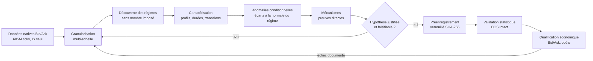
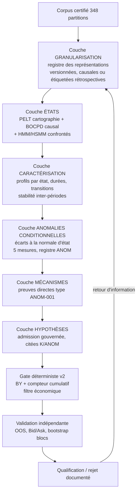

# META ALPHA — Regime Discovery & Market Granularization Blueprint
## Comprendre le marché XAUUSD avant de chercher des edges

**Statut : document de conception scientifique. Aucune expérience n'est lancée par ce
document, aucun régime n'est affirmé, aucun code n'est modifié.** Toutes les références
à nos résultats renvoient aux artefacts déjà committés du dépôt.

---

## 1. Diagnostic de notre approche actuelle

Nos vagues passées (P3-001, P3-002, P4-001) partageaient trois angles morts que ce
blueprint corrige :

1. **Analyse globale** : les statistiques conditionnelles étaient calculées sur tout
   l'IS mélangé. Si une structure n'existe que dans certains états du marché, la moyenne
   globale la dilue jusqu'à l'invisibilité — c'est exactement l'échec documenté :
   effets mid de 0,1 à 0,5 bp contre un spread médian de 2,17 bp (K2, K7, K8).
2. **Granularité unique** : tout était mesuré à l'échelle du tick événementiel avec des
   horizons fixes en secondes. Rien ne dit que les phénomènes vivent à cette échelle.
3. **Pas de représentation d'état** : nous n'avons jamais construit de variable d'état
   du marché (régime) estimée causalement ; les quintiles globaux IS utilisés en
   exploration mélangent passé et futur dans leurs seuils (limite déjà consignée).

Ce que nos résultats établissent déjà et qui motive la suite :

| Fait établi | Source | Implication pour la découverte de régimes |
|---|---|---|
| Effets directionnels globaux << spread | P3-001, P3-002 (0 survivant), P4-001 rejeté | Chercher des structures **conditionnelles à un état**, pas globales |
| Autocorrélation mid lag-1 = 0,487 ; bid 0,063 ; ask 0,060 ; mécanisme « mises à jour séparées » réfuté (98,5 % d'événements bilatéraux) | ANOM-001 | Il existe une structure fine bid/ask non expliquée : candidate à une analyse par régime/granularité |
| Regroupement de volatilité persistant (0,457 → 0,086, lags 1→50) | ANOM-002 | La volatilité a une mémoire longue : les régimes de volatilité sont une dimension d'état plausible |
| Volatilité élevée après gaps longs, sans direction | Audit gaps | Les événements (réouvertures) modifient l'état temporairement : granularité événementielle requise |
| Réversion descriptive du spread (-0,43) | Validation profonde | Le spread est une variable d'état dynamique, pas une constante |

**Principe directeur (charte)** : les hypothèses sont un produit de la recherche.
La chaîne devient : granulariser → découvrir les états → caractériser → détecter les
écarts conditionnels → comprendre les mécanismes → seulement alors, hypothèses.

## 2. État de l'art : découverte des régimes

Aucune méthode ne doit imposer le nombre de régimes à l'avance sans que ce choix soit
lui-même testé. Familles principales :

| Méthode | Phénomène révélable | Hypothèses | Limites | Coût sur 685M ticks | Risque de surapprentissage | Validation |
|---|---|---|---|---|---|---|
| HMM (Rabiner 1989 ; Hamilton 1989) | États latents discrets à transitions markoviennes, durées géométriques | Émissions paramétriques par état | Durées d'état irréalistes (géométriques) ; sensibilité à l'initialisation | Faible à modéré une fois les features agrégées ; impossible tick-par-tick brut | Modéré (nombre d'états à choisir) | Vraisemblance OOS, stabilité des profils entre sous-périodes |
| Hidden Semi-Markov (HSMM) | États à durées explicites (régimes persistants vs transitoires) | Distribution de durée par état | Plus de paramètres ; inférence plus lourde | Modéré | Modéré à élevé | Idem + distribution des durées prédite vs observée |
| Markov Switching (Hamilton 1989) | Changements de moyenne/variance d'une série macro-économétrique | Forme du processus par régime | Pensé pour séries agrégées basse fréquence | Faible sur séries granulées | Modéré | Tests de stabilité, prévisions OOS |
| Change-point offline : PELT (Killick, Fearnhead & Eckley 2012, DOI 10.1080/01621459.2012.737745) | Segmentation exacte en temps linéaire attendu, nombre de ruptures inconnu, piloté par pénalité | Coût par segment + pénalité choisie | Rétrospectif (non causal) ; le choix de pénalité décide du nombre de régimes | Linéaire : compatible avec des séries de features de 10⁶-10⁷ points | Élevé si pénalité ajustée sur le résultat ; à fixer a priori (BIC/MDL) | Stabilité de la segmentation entre sous-échantillons ; ne jamais utiliser les frontières rétrospectives comme features causales |
| BOCPD (Adams & MacKay 2007, arXiv:0710.3742) | Probabilité causale qu'un changement vient d'avoir lieu (posterior sur la longueur du run) | Hazard (souvent constant) ; modèle prédictif conjugué | Hypothèse de hazard ; dérive si le modèle prédictif est faux | Linéaire avec élagage ; causal par construction | Faible à modéré | Calibration des probabilités ; délai de détection mesuré sur ruptures connues (gaps) |
| Clustering non supervisé (k-means, GMM) sur features de fenêtres | États comme régions de l'espace des features | Distance/forme des clusters | Nombre de clusters arbitraire ; ignore la dynamique temporelle sauf features adaptées | Faible | Élevé (choix de k, de features, d'échelle) | Stabilité (bootstrap des clusters, indices de silhouette/ Davies-Bouldin), persistance temporelle des étiquettes |
| Mixture models / modèles à classes latentes dynamiques | Régimes probabilistes avec appartenance douce | Famille de mélange | Interprétation parfois floue | Modéré | Modéré | Vraisemblance prédictive OOS |
| State-space / filtres (Kalman, particulaire) | État latent continu (volatilité latente, niveau) | Dynamique linéaire/gaussienne ou modèle explicite | Spécification du modèle critique | Modéré à élevé | Modéré | Innovations blanches, couverture prédictive |
| Détection informationnelle (divergences, compression) | Ruptures comme chutes de prédictibilité/compressibilité entre fenêtres | Choix de la fenêtre et du codeur | Interprétation indirecte | Modéré | Faible à modéré | Comparaison à des séries de contrôle (permutations) |
| Revue de référence | Truong, Oudre & Vayatis (2020), *Selective Review of Offline Change Point Detection Methods*, Signal Processing | — | — | — | — | Cadre coût/recherche/contrainte |

**Recommandation META ALPHA** : commencer par les méthodes dont le nombre d'états est
une **sortie** et non une entrée — PELT (rétrospectif, pour cartographier) et BOCPD
(causal, pour l'usage ultérieur) — sur des séries de features granulées, puis confronter
à un HMM/HSMM dont le nombre d'états sera choisi par vraisemblance prédictive OOS et
stabilité, jamais par l'œil. Toute segmentation rétrospective est une carte, pas un
outil causal : ses frontières ne doivent jamais alimenter des features du passé.

## 3. Granularisation : découper le comportement sans l'imposer

Le tick brut n'est qu'une échelle parmi d'autres. Chaque granularisation est une
hypothèse de représentation, à justifier et à comparer — jamais un catalogue de
stratégies.

| Granularisation | Construction (compatible Bid/Ask) | Peut révéler | Limites spécifiques à notre corpus |
|---|---|---|---|
| Temporelle (secondes/minutes) | Agrégats par horloge | Rythmes journaliers, effets d'annonces | Sessions non documentées chez nous (SUBPERIODE bloquée) : ne pas inventer les heures ; trous de marché à traiter comme ruptures |
| Par nombre de cotations (tick bars) | Une barre tous les N événements | Structures indépendantes de l'horloge | Mélange des périodes calmes et intenses |
| Par activité | Barres fermées après X mises à jour ou Y variation cumulée d'intensité | États d'activité comparables entre jours calmes et agités | Seuil d'activité à fixer a priori |
| Par volatilité | Barres fermées après variation absolue cumulée θ (inspiré des « clocks » d'Easley & López de Prado, adaptés : nous n'avons ni trades ni volume réel) | Échantillonnage uniforme en risque : chaque barre = même quantité de mouvement | θ arbitraire si non justifié ; sensibilité à tester, pas à optimiser |
| Par spread | Segmentation quand le spread franchit des bandes mesurées (K2) | États de liquidité et leurs dynamiques propres | Le spread est endogène : risque de circularité dans les features |
| Événementielle | Fenêtres ancrées sur gaps, sauts, extrêmes mesurés | Dynamique pré/post événement (réouvertures, K-audit) | Biais de sélection d'événements : toujours apparier à des périodes témoins |
| Par changements de prix | Barres fermées après déplacement cumulé du mid de δ | Structure des impulsions et de leur digestion | Dépend de la construction du mid (cf. ANOM-001) |
| Par intensité | Fenêtres à nombre d'événements par seconde homogène | Régimes d'arrivée des cotations (processus ponctuel) | Intensité corrélée à la volatilité : interactions à démêler |
| Par séquences | Motifs d'événements (types de mises à jour bid/ask) | Microstructure fine (la piste lead-lag d'ANOM-001 vit ici) | Espace combinatoire : interdiction des produits cartésiens de motifs |
| Multi-échelle | Mêmes mesures à plusieurs échelles emboîtées | Phénomènes qui n'existent qu'à une échelle (ex. autocorrélation mid à 1 tick, absente à 100 ?) | Multiplicité des échelles = multiplicité des tests (compteur cumulatif) |
| Adaptative | Échelle choisie par le niveau d'activité/volatilité local | Comparer « à information égale » plutôt qu'à temps égal | La règle d'adaptation fait partie du protocole préenregistré |
| Conditionnelle | Découpage par état estimé causalement (ex. tercile de volatilité passée, protocole REGIME approuvé) | Anomalies visibles seulement dans un état | L'état doit être causal (passé seul), protocole déjà approuvé mais non certifié chez nous |

**Critère de comparaison des granularisations** : une granularité est meilleure si, à
protocole égal, elle rend une structure (a) plus stable entre sous-périodes, (b) plus
concentrée (moins diluée), (c) avec des durées d'état plus interprétables — jamais si
elle produit un meilleur « backtest ».

## 4. Détection d'anomalies conditionnelles

Objectif : un écart n'a de sens que **relativement à la normale de son régime et de son
échelle**. Méthodes candidates, toutes à appliquer sur des représentations déjà
caractérisées, jamais comme signaux directs :

| Méthode | Écart détecté | Conditions d'usage chez nous |
|---|---|---|
| Scores robustes intra-régime (médiane/MAD par état) | Observation extrême pour son état | Exige un état causal ; seuils fixés a priori |
| Densité conditionnelle (KDE, GMM par régime) | Points de faible densité locale | Sensible à la dimension ; features peu nombreuses et justifiées |
| Local Outlier Factor / isolation forest (sur features de fenêtres) | Anomalies multivariées contextuelles | Outils d'exploration ; taux de contamination = paramètre à documenter, pas à régler |
| Anomalies séquentielles (résidus de modèle prédictif causal) | Rupture de prédictibilité locale | Le modèle de référence doit être simple et gelé |
| Événements rares et queues (EVT, pics au-delà d'un seuil — méthode POT de la théorie des valeurs extrêmes) | Extrêmes de distribution par régime | Seuils extrêmes = peu d'événements : effectifs toujours rapportés |
| Décalages de distribution (tests deux-échantillons glissants, MMD) | Changement de régime progressif | Fenêtres et statistiques préenregistrées |
| Anomalies de transition | Transitions d'état jamais ou rarement observées | Exige la matrice de transition estimée sur IS avec intervalles |

**Règle d'or** : une anomalie conditionnelle documentée (les 5 mesures de la charte)
peut ensuite seulement donner lieu à une étude de mécanisme. Détection ≠ prédiction.

## 5. Transitions et interactions

À étudier comme objets scientifiques en soi, sur représentations granulées :
matrices de transition entre états (avec intervalles de confiance par comptage),
distributions de durée par état (persistants vs transitoires), transitions rapides
vs graduelles (comparer BOCPD causal et segmentation rétrospective), et interactions
préenregistrées en petit nombre et justifiées par la base K — par exemple :
volatilité × spread (le spread s'élargit-il avant, pendant ou après les pics de
volatilité ?), intensité × variation (l'activité précède-t-elle le mouvement ou le
suit-elle ?), autocorrélation du mid × régime (l'anomalie ANOM-001 est-elle concentrée
dans certains états ?), sauts × transitions (les sauts sont-ils des marqueurs de
changement d'état ?). Chaque interaction étudiée entre au compteur cumulatif.

## 6. Ce que fait la recherche institutionnelle (sources publiques uniquement)

Sans rien inventer de propriétaire : la littérature publique documente (i) la
segmentation des marchés en états latents estimés sur features multi-fréquences
plutôt que sur prix bruts ; (ii) l'usage de modèles à changement de régime depuis
Hamilton (1989) jusqu'aux implémentations modernes revues par Truong et al. (2020) ;
(iii) l'échantillonnage en « horloge d'activité » plutôt qu'en horloge calendaire
(Easley, López de Prado & O'Hara sur les flux de transactions — **non transposable tel
quel chez nous : pas de trades, pas de volume réel**) ; (iv) la discipline de validation :
séparation temporelle stricte, correction des tests multiples et « deflated » des
performances (Bailey & López de Prado 2014 ; Harvey, Liu & Zhu 2016 sur la
prolifération des facteurs). Leur point commun exploitable : **la représentation
précède la prédiction, et la validation est indépendante de la découverte.**

## 7. Compatibilité avec notre corpus — contraintes non négociables

- Tick = cotation, pas transaction : pas de volume, delta, carnet, ni exécution inférés.
- Mid = construction (ANOM-001) : toute statistique sur rendements mid doit être
  doublée, quand c'est pertinent, d'un contrôle sur jambes bid/ask séparées.
- Deux signatures de schéma (K6) : lecture par nom, `union_by_name=true` sur glob.
- Trous de marché (K5) : ruptures, jamais traversés silencieusement par une fenêtre.
- Causalité : états et seuils estimés sur le passé seul ; les segmentations
  rétrospectives sont des cartes descriptives étiquetées comme telles.
- Échantillons : découverte sur IS seul ; OOS intact pour confirmation ; Holdout scellé.
- Calcul : CPU, DuckDB borné, par partitions avec checkpoints ; 685M ticks ne se
  chargent jamais en mémoire — toute méthode doit donc travailler sur des **séries de
  features granulées** (10⁵-10⁷ points), pas sur le flux brut.

## 8. Architecture scientifique cible

Chaque couche écrit ses artefacts dans Git (rapports, registres chaînés, hashes) ;
aucune couche ne peut court-circuiter la précédente. Le retour d'information après
échec repart de la granularisation ou des états — jamais d'un reparamétrage d'hypothèse.

## 9. Plan de recherche progressif (chaque étape conditionnée par la précédente)

1. **Représentations** : construire 3 granularisations justifiées (tick-événementielle
   de référence ; activité ; volatilité-cumulée) et leurs séries de features causales
   (volatilité réalisée, spread, intensité, autocorrélations roulantes) sur IS.
2. **Cartographie** : segmentation PELT (pénalité BIC fixée a priori) sur ces séries ;
   profils des segments ; stabilité par tiers d'IS.
3. **États causaux** : BOCPD sur les mêmes séries ; comparer ses alertes aux frontières
   de la carte ; HMM à K états choisi par validation prédictive, confronté aux deux.
4. **Caractérisation** : durées, transitions, profils multivariés des états retenus ;
   écarter les états non stables entre sous-périodes (résultat négatif conservé).
5. **Anomalies conditionnelles** : écarts intra-état (robustes, densité, extrêmes) sur
   un petit nombre de dimensions justifiées ; mesures complètes au registre ANOM.
6. **Mécanismes** : preuves directes (décompositions, témoins appariés) avant toute
   lecture prédictive. Inclut la mesure lead-lag bid/ask laissée ouverte par ANOM-001.
7. **Hypothèses** : seulement issues des étapes 5-6, admission gouvernée, préenregistrement
   verrouillé, gate v2, puis OOS.

## 10. Validation, faux positifs, faux négatifs, conditions d'arrêt

- **Faux positifs** : multiplicité (échelles × états × dimensions) comptée au compteur
  cumulatif (BY) ; stabilité exigée sur au moins 2 des 3 tiers d'IS ; confirmation OOS
  obligatoire ; aucun seuil « optimisé ».
- **Faux négatifs** : une structure peut être manquée si la granularité est mauvaise ;
  d'où la comparaison explicite d'au moins 3 représentations avant de conclure à
  l'absence — et la conclusion autorisée reste « non détecté à ces échelles », jamais
  « inexistant ».
- **Artefacts à traquer en permanence** : construction du mid (ANOM-001), frontières de
  partitions, trous de marché, changements de schéma 294/295, sélection cumulative sur IS.
- **Conditions d'arrêt d'une piste** : phénomène non stable entre tiers d'IS ; amplitude
  structurellement inférieure au spread sans mécanisme de coût différent ; mécanisme
  réfuté par preuve directe (précédent ANOM-001). Arrêt = rejet documenté et conservé.
- **Condition d'arrêt globale** : si, après les étapes 1 à 6 sur IS, aucun phénomène ne
  dépasse le stade descriptif avec stabilité, la conclusion scientifique est
  l'absence de structure exploitable détectée — un résultat complet, pas un échec.

## 11. Bibliographie vérifiable (sélection)

- Hamilton, J. D. (1989). *A New Approach to the Economic Analysis of Nonstationary Time Series and the Business Cycle*. Econometrica 57(2), 357-384.
- Rabiner, L. R. (1989). *A Tutorial on Hidden Markov Models and Selected Applications in Speech Recognition*. Proceedings of the IEEE 77(2), 257-286.
- Adams, R. P. & MacKay, D. J. C. (2007). *Bayesian Online Changepoint Detection*. arXiv:0710.3742. [1](https://www.alphaxiv.org/abs/0710.3742)
- Killick, R., Fearnhead, P. & Eckley, I. A. (2012). *Optimal Detection of Changepoints with a Linear Computational Cost*. JASA 107(500), 1590-1598. DOI 10.1080/01621459.2012.737745.
- Truong, C., Oudre, L. & Vayatis, N. (2020). *Selective Review of Offline Change Point Detection Methods*. Signal Processing 167, 107299.
- Engle, R. F. (1982). *Autoregressive Conditional Heteroscedasticity…*. Econometrica 50(4), 987-1007. — Bollerslev, T. (1986). *Generalized Autoregressive Conditional Heteroskedasticity*. Journal of Econometrics 31(3), 307-327.
- Cont, R. (2001). *Empirical Properties of Asset Returns: Stylized Facts and Statistical Issues*. Quantitative Finance 1(2), 223-236.
- Easley, D., López de Prado, M. & O'Hara, M. (2012). *Flow Toxicity and Liquidity in a High-Frequency World*. Review of Financial Studies 25(5), 1457-1493. (Contexte horloges d'activité ; non transposable tel quel à des cotations sans trades.)
- Bailey, D. H. & López de Prado, M. (2014). *The Deflated Sharpe Ratio*. Journal of Portfolio Management 40(5), 94-107.
- Harvey, C. R., Liu, Y. & Zhu, H. (2016). *…and the Cross-Section of Expected Returns*. Review of Financial Studies 29(1), 5-68.
- Benjamini, Y. & Yekutieli, D. (2001). *The Control of the False Discovery Rate in Multiple Testing under Dependency*. Annals of Statistics 29(4), 1165-1188.
- Coles, S. (2001). *An Introduction to Statistical Modeling of Extreme Values*. Springer. (Méthode POT pour les queues.)

---

*Fin du blueprint. Prochaine décision : le propriétaire choisit s'il autorise l'étape 1
(représentations granulées sur IS). Aucune vague P3-003 n'est créée par ce document.*
