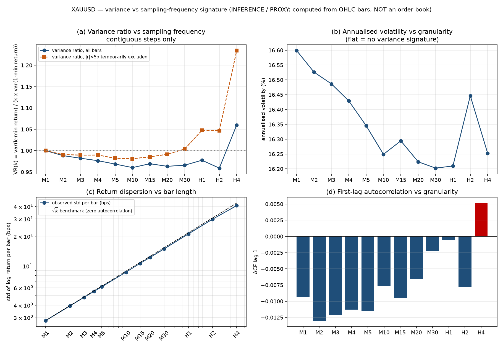
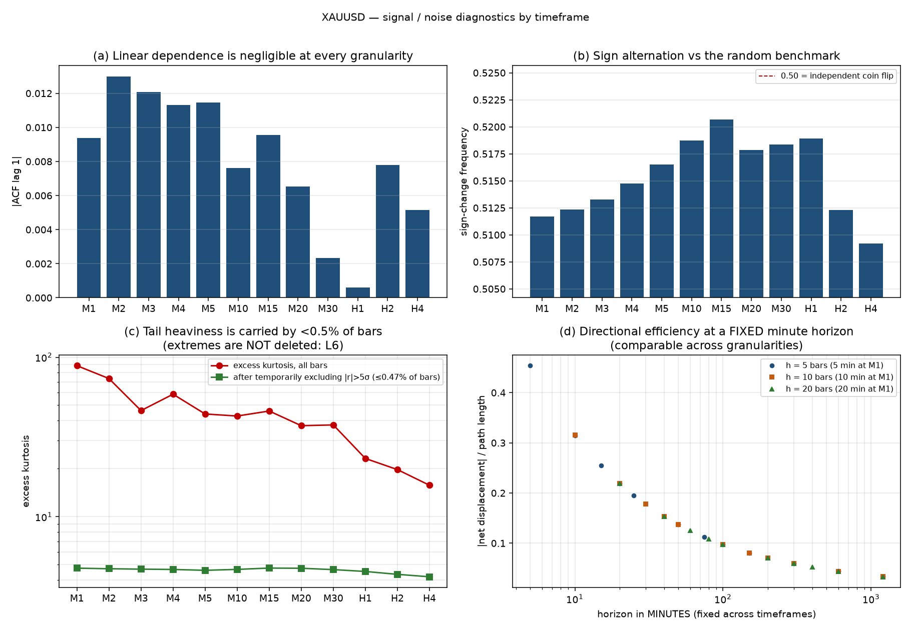
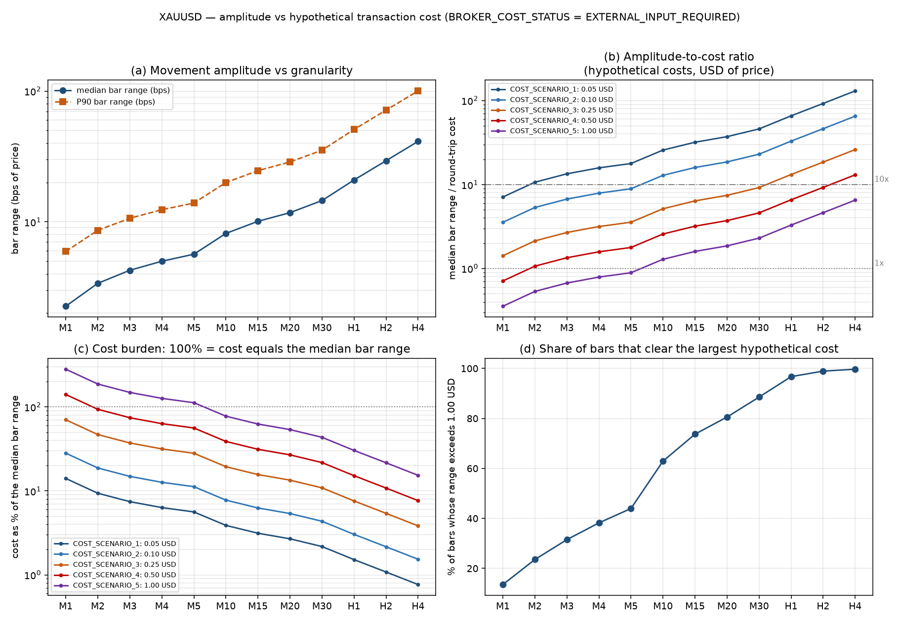

# PHASE 2 — TIMEFRAME / GRANULARITY / SIGNAL-TO-NOISE / AMPLITUDE-TO-COST

**Asset:** XAUUSD (gold spot, USD per troy ounce — nominal unit as delivered)  
**Phase:** 2 of the pre-regime, pre-strategy research programme  
**Status of Phase 1:** CLOSED (`DATASET_STATUS = PASS_WITH_LIMITATIONS`, commit `82d0823`)  
**Phase 2 status:** `PHASE_2_STATUS = COMPLETE`  
**Generated (UTC):** 2026-09-06T09:35:02+00:00  
**Scope:** determine the temporal granularity that best balances structure preservation, noise reduction, observable signal persistence, temporal robustness, movement amplitude and cost relative to movement. **Not** to find a profitable timeframe.

---

## 1. Executive summary

Twelve granularities (M1, M2, M3, M4, M5, M10, M15, M20, M30, H1, H2, H4) were built deterministically from the single Phase-1 M1 substrate (5,874,003 bars, 2010-01-01 → 2026-08-30, UTC) and measured on ~90 statistics each.

**The five findings that survive every robustness check applied:**

1. **No granularity converts noise into signal.** Across the whole grid the first-lag autocorrelation of log returns stays inside ±0.013 on the full sample (inside ±0.020 on contiguous steps only), the sign-change frequency stays inside 0.5092–0.5207 against a 0.5000 independent benchmark, and the variance ratio stays inside 0.96–1.06. There is no timeframe in the M1→H4 range at which a linear signal emerges. Timeframe choice on this dataset cannot be justified on 'signal' grounds.
2. **The tail gradient is an artefact of <0.5% of bars.** Excess kurtosis falls from 88.6 (M1) to 15.7 (H4) — apparently a huge noise-reduction gain from aggregation. Temporarily excluding the ≤0.47% of bars whose return exceeds 5σ collapses it to 4.75 (M1) and 4.19 (H4). The entire 'coarse timeframes are cleaner' gradient is produced by a few hundred extreme bars, not by the scale of observation. Extremes were **not** deleted (limitation L6).
3. **One real structural transition exists, around 30–60 minutes.** On contiguous steps only, the variance ratio declines from 1.000 (M1) to 0.960 (M10) and then **rises back above 1** at H1–H4 (1.060 at H4). Below roughly half an hour the series is mildly mean-reverting; above roughly one hour it is mildly trend-persistent. This is the only scale-dependent change of character found anywhere in the grid.
4. **Continuity collapses above H1.** The share of bars that silently contain a missing-data gap goes 0.00% (M1–M2) → 0.11% (M3) → 3.16% (H1) → **16.46% (H4)**, and 10.23% of H4 bars contain an internal market break (weekend / overnight). An H4 'bar' is frequently not a homogeneous observation and is rejected on that basis.
5. **The composite score has a plateau, not a peak.** The `GRANULARITY_QUALITY_SCORE` returns M1 = 0.6275, M3 = 0.6203, M2 = 0.6143, M5 = 0.5797 — a 0.0132 spread across the top three against a 0.1750 total range. All eleven robustness variants put the winner inside {M1, M2, M3, M5}; the ordering *inside* that set flips depending on whether three noise-dominated sub-components are included.

**Decision (full justification in §18):** `PRIMARY_TIMEFRAME = M3`, `SECONDARY_TIMEFRAME = M1`, `CONTEXT_TIMEFRAME = H1`. H4 is rejected. Confidence is HIGH on the M1–M5 zone, MODERATE on M3 specifically, LOW on any finer distinction.

---

## 2. Dataset used

| item | value |
|---|---|
| Instrument | XAUUSD (gold spot) |
| Source files | `XAUUSD_part_01..07.parquet.part` (7 fragments, unmodified) |
| Reconstruction | the 7 fragments are concatenated in their physical parquet row-group/page order (Phase 1 section 3); no row is dropped, reordered, de-duplicated or modified |
| Verification | master SHA-256 re-checked at the start of Phase 2 and byte-identical to Phase 1 |
| M1 master | `/tmp/xauusd_audit/XAUUSD_M1_reconstructed.parquet` |
| M1 master SHA-256 | `fdce55a8c8a76c417765ad020794866bb36e5b166c130d2bb4deb2aeeeab91d0` |
| M1 bars | 5,874,003 |
| Span (UTC) | 2010-01-01T00:02:00.000000000 → 2026-08-30T23:58:00.000000000 |
| Years covered | 16.663 (2010-01-01 → 2026-08-30) |
| Timezone | UTC throughout; no local-time conversion applied |
| Volume column | **never loaded** (Phase 1 limitation L1: unit unknown) |

The Phase-1 master SHA-256 above is byte-identical to the file that produced the Phase-1 report. No source fragment was read for anything other than reading.

---

## 3. Limitations inherited from Phase 1 (binding in Phase 2)

| id | limitation | consequence in Phase 2 |
|---|---|---|
| L1 | Volume unit is unknown | the volume column is never loaded, used or derived; no volume-weighted statistic exists anywhere in this phase |
| L2 | No gap filling | aggregation never pads a window; a bar with 1 of 3 M1 minutes present is a 1-minute bar and is flagged as such |
| L3 | No price-decimal homogenisation | all amplitude figures are computed on the prices as delivered, in USD and in basis points of the contemporaneous price |
| L4 | Session-convention break around 2013 | treated explicitly in §13 as a structural split, not smoothed away |
| L5 | 2026 is a partial year (Jan–Aug) | reported as `2026_SANITY_CHECK` only; it never enters any score, ranking or selection |
| L6 | Extremes stay in the data | no winsorisation, no trimming; the 5σ exercise in §6 is a *sensitivity exclusion*, reported side by side and never substituted for the main result |
| L7 | Sources are never modified | all seven fragments verified unmodified after this phase |

Two Phase-2-specific additions:

* **L8 — no order book.** Everything below is computed from OHLC bars. Any statement about microstructure is labelled `INFERENCE / PROXY`. No bid, no ask, no tick, no depth was observed.
* **L9 — no broker cost exists in the repo.** All costs used here are hypothetical scenario values. `BROKER_COST_STATUS = EXTERNAL_INPUT_REQUIRED`.

---

## 4. Aggregation method

| parameter | value |
|---|---|
| Origin | 1970-01-01T00:00:00Z (unix epoch) |
| Alignment | bar_id = floor(epoch_minutes / k) |
| Timezone | UTC |
| Aggregation | {'open': 'first', 'high': 'max', 'low': 'min', 'close': 'last'} |
| Gap policy | none - no window is padded, no M1 bar is invented |
| Volume | excluded (Phase 1 limitation L1) |
| Market-break threshold | 50 minutes of missing M1 data inside a bar counts as an internal market break |

Rules, all deterministic and reproducible:

1. Every M1 bar is assigned `bar_id = floor(epoch_minutes_utc / k)`; the origin is the UNIX epoch, **not** the first bar of the dataset, so the grid is identical for anyone re-running the script and is independent of where the data happens to start.
2. `Open = first`, `High = max`, `Low = min`, `Close = last` of the M1 bars in the window, in timestamp order.
3. **No gap is filled and no M1 bar is invented.** A window with zero M1 bars does not exist in the output. A window with 2 of 5 M1 bars produces a bar whose High/Low span only those 2 minutes.
4. Volume is dropped at construction time, not later.
5. Each output bar carries `n_m1`, `internal_missing` (missing M1 minutes strictly inside the window), `internal_breaks` (market breaks inside) and `contig_next` (is the next calendar bar present?). These counters are what make §11–§12 auditable.

Everything downstream reads only these files; the M1 master is never re-aggregated ad hoc.

---

## 5. Granularity grid

| TF | min | bars | % of M1 bars | mean M1/bar | contiguous steps | first (UTC) | last (UTC) |
|---|---|---|---|---|---|---|---|
| M1 | 1 | 5,874,003 | 100.0000% | 1.000 | 99.733% | 2010-01-01T00:02:00 | 2026-08-30T23:58:00 |
| M2 | 2 | 2,943,158 | 50.1048% | 1.996 | 99.467% | 2010-01-01T00:02:00 | 2026-08-30T23:58:00 |
| M3 | 3 | 1,963,826 | 33.4325% | 2.991 | 99.315% | 2010-01-01T00:00:00 | 2026-08-30T23:57:00 |
| M4 | 4 | 1,473,625 | 25.0872% | 3.986 | 99.200% | 2010-01-01T00:00:00 | 2026-08-30T23:56:00 |
| M5 | 5 | 1,179,286 | 20.0764% | 4.981 | 99.147% | 2010-01-01T00:00:00 | 2026-08-30T23:55:00 |
| M10 | 10 | 589,924 | 10.0430% | 9.957 | 98.805% | 2010-01-01T00:00:00 | 2026-08-30T23:50:00 |
| M15 | 15 | 393,361 | 6.6966% | 14.933 | 98.511% | 2010-01-01T00:00:00 | 2026-08-30T23:45:00 |
| M20 | 20 | 295,066 | 5.0233% | 19.907 | 98.107% | 2010-01-01T00:00:00 | 2026-08-30T23:40:00 |
| M30 | 30 | 196,738 | 3.3493% | 29.857 | 97.515% | 2010-01-01T00:00:00 | 2026-08-30T23:30:00 |
| H1 | 60 | 98,412 | 1.6754% | 59.688 | 95.699% | 2010-01-01T00:00:00 | 2026-08-30T23:00:00 |
| H2 | 120 | 51,055 | 0.8692% | 115.052 | 92.157% | 2010-01-01T00:00:00 | 2026-08-30T22:00:00 |
| H4 | 240 | 26,452 | 0.4503% | 222.063 | 95.671% | 2010-01-01T00:00:00 | 2026-08-30T20:00:00 |

**Exclusions.** All twelve granularities are technically sound and all twelve are reported. No granularity was dropped from the grid. H4 is *rejected as a candidate* in §18 on continuity grounds, but its measurements are retained everywhere — rejection is a conclusion, not a deletion.

---

## 6. Noise diagnostic

### 6.1 Autocorrelation

| TF | ACF lag1 | lag2 | lag3 | lag4 | lag8 |
|---|---|---|---|---|---|
| M1 | -0.00939 | -0.00618 | -0.00370 | +0.00065 | -0.00259 |
| M2 | -0.01298 | -0.00148 | -0.00338 | -0.00593 | +0.00038 |
| M3 | -0.01208 | -0.00468 | -0.00495 | +0.00034 | +0.00173 |
| M4 | -0.01131 | -0.00416 | -0.00181 | -0.00052 | -0.00110 |
| M5 | -0.01145 | -0.00199 | -0.00228 | +0.00047 | +0.00039 |
| M10 | -0.00763 | +0.00045 | -0.00184 | +0.00111 | +0.00058 |
| M15 | -0.00955 | +0.00048 | -0.00561 | +0.00298 | -0.00451 |
| M20 | -0.00653 | -0.00052 | +0.00280 | -0.00114 | +0.00209 |
| M30 | -0.00232 | -0.00393 | +0.00123 | -0.00444 | -0.00171 |
| H1 | -0.00061 | -0.00459 | +0.00275 | +0.00214 | +0.00849 |
| H2 | -0.00779 | +0.00991 | +0.00250 | +0.01355 | +0.01559 |
| H4 | +0.00515 | -0.01271 | +0.01842 | -0.00363 | -0.00823 |

Every value sits inside ±0.019. Sampling error at the coarsest granularity (1/√26,452 ≈ 0.0061) is of the same order as the largest value measured, so the *pattern* across lags carries no information; only the *absence of any material autocorrelation* is a finding.

### 6.2 Sign alternation and run lengths

| TF | sign-change freq | mean run | median run | P90 run | max run | mean run (minutes) |
|---|---|---|---|---|---|---|
| M1 | 0.51169 | 1.9098 | 1.0 | 4 | 24 | 1.91 |
| M2 | 0.51236 | 1.9203 | 1.0 | 4 | 21 | 3.84 |
| M3 | 0.51326 | 1.9223 | 1.0 | 4 | 20 | 5.77 |
| M4 | 0.51474 | 1.9188 | 1.0 | 4 | 26 | 7.68 |
| M5 | 0.51651 | 1.9136 | 1.0 | 4 | 22 | 9.57 |
| M10 | 0.51872 | 1.9045 | 1.0 | 4 | 16 | 19.04 |
| M15 | 0.52067 | 1.8932 | 1.0 | 4 | 14 | 28.40 |
| M20 | 0.51784 | 1.8978 | 1.0 | 4 | 20 | 37.96 |
| M30 | 0.51835 | 1.8850 | 1.0 | 4 | 14 | 56.55 |
| H1 | 0.51890 | 1.8515 | 1.0 | 3 | 13 | 111.09 |
| H2 | 0.51230 | 1.8085 | 1.0 | 3 | 11 | 217.02 |
| H4 | 0.50918 | 1.8842 | 1.0 | 4 | 11 | 452.22 |

A sequence of independent up/down signs has sign-change frequency 0.5000 and mean run 2.0. The whole grid sits at 0.5092–0.5207 and 1.808–1.922 — i.e. uniformly *slightly more alternating than a coin flip*, which is the same weak negative dependence the ACF shows. The mean run expressed in **minutes** is the informative column: the average directional run lasts 1.91 minutes at M1 and 452 minutes at H4 — close to 1.9 x k at every granularity, i.e. the run length in minutes is just the bar length rescaled. There is no granularity at which directional runs become systematically longer *in minutes* than the bar that measures them.

### 6.3 Ultra-short reversals

| TF | reversal freq | median recovery ratio | full recovery rate | full recovery (big moves) | mean delay (bars) | median delay (bars) | no recovery within 20 bars |
|---|---|---|---|---|---|---|---|
| M1 | 0.51169 | 1.0000 | 0.5003 | 0.2877 | 4.494 | 3 | 24.20% |
| M2 | 0.51236 | 0.9815 | 0.4953 | 0.2827 | 4.484 | 3 | 24.14% |
| M3 | 0.51326 | 0.9750 | 0.4933 | 0.2816 | 4.473 | 3 | 24.10% |
| M4 | 0.51474 | 0.9680 | 0.4915 | 0.2791 | 4.472 | 3 | 24.12% |
| M5 | 0.51651 | 0.9646 | 0.4902 | 0.2782 | 4.470 | 3 | 24.04% |
| M10 | 0.51872 | 0.9550 | 0.4868 | 0.2724 | 4.452 | 3 | 24.09% |
| M15 | 0.52067 | 0.9489 | 0.4848 | 0.2704 | 4.451 | 3 | 24.14% |
| M20 | 0.51784 | 0.9568 | 0.4875 | 0.2698 | 4.464 | 3 | 24.07% |
| M30 | 0.51835 | 0.9439 | 0.4832 | 0.2633 | 4.448 | 2 | 24.19% |
| H1 | 0.51890 | 0.9403 | 0.4814 | 0.2630 | 4.397 | 2 | 24.88% |
| H2 | 0.51230 | 0.8887 | 0.4644 | 0.2403 | 4.424 | 2 | 25.54% |
| H4 | 0.50918 | 0.9215 | 0.4768 | 0.2462 | 4.490 | 2 | 25.40% |

Reversal frequency is 0.509–0.521 everywhere: after a down bar, an up bar follows about as often as a coin decides. The recovery ratio (how far the reversal retraces the triggering move) falls from 1.000 at M1 to 0.889 at H2 (0.922 at H4), and the mean recovery delay is **4.4–4.5 bars at every single granularity** — from 1-minute bars to 4-hour bars. That invariance is the clearest statement available: the number of observations needed to undo a move is a constant in *bar count*, not in time, so coarser bars do not make reversals rarer, they only make them slower in wall-clock terms.

### 6.4 Distribution, moments and tails

| TF | std (bps) | annualised vol % | skew | excess kurtosis | excess kurtosis (5σ excl.) | bars excluded | |r|>2σ | |r|>3σ |
|---|---|---|---|---|---|---|---|---|
| M1 | 2.7956 | 16.599 | -0.5604 | 88.59 | 4.75 | 0.401% | 4.487% | 1.645% |
| M2 | 3.9322 | 16.526 | -0.5650 | 73.53 | 4.71 | 0.411% | 4.484% | 1.651% |
| M3 | 4.8023 | 16.487 | -0.4005 | 46.29 | 4.68 | 0.414% | 4.467% | 1.670% |
| M4 | 5.5245 | 16.429 | -0.4177 | 58.64 | 4.66 | 0.410% | 4.517% | 1.668% |
| M5 | 6.1442 | 16.346 | -0.3033 | 44.07 | 4.60 | 0.423% | 4.494% | 1.657% |
| M10 | 8.6357 | 16.249 | -0.3751 | 42.79 | 4.66 | 0.421% | 4.524% | 1.688% |
| M15 | 10.6050 | 16.294 | -0.4166 | 45.99 | 4.75 | 0.427% | 4.488% | 1.705% |
| M20 | 12.1917 | 16.224 | -0.4677 | 37.21 | 4.74 | 0.428% | 4.583% | 1.719% |
| M30 | 14.9110 | 16.202 | -0.7990 | 37.62 | 4.65 | 0.444% | 4.689% | 1.708% |
| H1 | 21.0920 | 16.210 | -0.5623 | 23.17 | 4.52 | 0.464% | 4.711% | 1.781% |
| H2 | 29.7115 | 16.446 | -0.4927 | 19.72 | 4.34 | 0.419% | 4.954% | 1.841% |
| H4 | 40.7909 | 16.253 | -0.2824 | 15.73 | 4.19 | 0.423% | 4.900% | 1.770% |

**This is the most important table in the phase.** Read the kurtosis columns together. The apparent gradient 88.6 → 15.7 says 'aggregation removes noise'. The right-hand column says otherwise: removing between 0.40% and 0.47% of bars takes excess kurtosis to 4.19–4.75 at *every* granularity — nearly flat, and modest. The heavy tail is not a property of the sampling frequency; it is a property of a few hundred specific minutes (news, fix-related spikes, thin-liquidity prints) whose effect aggregation merely smears across a wider window. Aggregation does not remove those events from the sample, it dilutes their per-bar impact.

Annualised volatility is flat at 16.2–16.6% across a 240× frequency range, which is the same fact seen from the other side: there is no frequency at which XAUUSD variance behaves differently in aggregate.

### 6.5 Variance-vs-sampling-frequency signature (INFERENCE / PROXY)

Computed on **contiguous steps only** — a consecutive pair of rows whose `bar_id` differ by exactly 1 and whose bars contain no missing M1 minute. This matters: a gap-spanning return carries minutes of movement that belong to no bar, and gaps are 0.27% of M1 steps but affect 16% of H4 bars, so an unfiltered variance ratio is biased against the coarse end.

| TF | contiguous steps | std (bps) | std excl. 5σ (bps) | VR(k) | VR(k) excl. 5σ | ACF lag 1 (contiguous) | VR implied by ACF1 alone |
|---|---|---|---|---|---|---|---|
| M1 | 5,858,303 | 2.7956 | 2.3411 | 1.0000 | 1.0000 | -0.00938 | 0.9812 |
| M2 | 2,935,447 | 3.9306 | 3.2955 | 0.9884 | 0.9907 | -0.01344 | 0.9731 |
| M3 | 1,954,186 | 4.7991 | 4.0338 | 0.9823 | 0.9896 | -0.01224 | 0.9755 |
| M4 | 1,462,180 | 5.5253 | 4.6583 | 0.9766 | 0.9898 | -0.01209 | 0.9758 |
| M5 | 1,166,159 | 6.1523 | 5.1881 | 0.9686 | 0.9822 | -0.01276 | 0.9745 |
| M10 | 577,109 | 8.6633 | 7.3333 | 0.9603 | 0.9812 | -0.00776 | 0.9845 |
| M15 | 381,809 | 10.6606 | 9.0008 | 0.9694 | 0.9854 | -0.00975 | 0.9805 |
| M20 | 284,212 | 12.2712 | 10.4256 | 0.9634 | 0.9916 | -0.00603 | 0.9879 |
| M30 | 186,893 | 15.0489 | 12.8465 | 0.9659 | 1.0037 | -0.00322 | 0.9936 |
| H1 | 90,205 | 21.4105 | 18.5610 | 0.9776 | 1.0476 | +0.00006 | 1.0001 |
| H2 | 45,759 | 29.9922 | 26.2402 | 0.9591 | 1.0469 | -0.00544 | 0.9891 |
| H4 | 17,657 | 44.5901 | 40.2952 | 1.0600 | 1.2343 | +0.01921 | 1.0384 |

`VR(k) = var(k-minute return) / (k × var(1-minute return))`. VR = 1 is a pure random walk; VR < 1 indicates mean reversion (or, indistinguishably from OHLC data, a bid/ask-type bounce); VR > 1 indicates persistence/trending.

* M1 → M10: VR falls 1.000 → 0.960. The fine end is mildly mean-reverting.
* M10 → M30: VR is flat at 0.96.
* H1 → H4: VR **rises back through 1.0** (0.978 → 1.060; 1.048 → 1.234 once 5σ bars are temporarily excluded). The coarse end is mildly trend-persistent.

The crossing sits between M30 and H1, i.e. **between roughly 30 and 60 minutes**. This is the only scale-dependent change of character anywhere in the grid and it is labelled `INFERENCE / PROXY`: it is a statement about the second-moment structure of OHLC bar returns, not an order-book observation (L8).



---

## 7. Observable signal and structure

### 7.1 Directional efficiency — and why the naive comparison is invalid

Directional efficiency is `|close(t+h) − close(t)| / Σ|Δclose|` over h bars.

| TF | DE h=5 (tf bars) | DE h=10 | DE h=20 | DE h=5 (M1 resolution) | DE h=10 (M1 res.) | DE h=20 (M1 res.) |
|---|---|---|---|---|---|---|
| M1 | 0.4538 | 0.3151 | 0.2192 | 0.4538 | 0.3151 | 0.2192 |
| M2 | 0.4478 | 0.3105 | 0.2167 | 0.3150 | 0.2191 | 0.1534 |
| M3 | 0.4442 | 0.3082 | 0.2161 | 0.2547 | 0.1777 | 0.1251 |
| M4 | 0.4431 | 0.3080 | 0.2170 | 0.2192 | 0.1534 | 0.1086 |
| M5 | 0.4408 | 0.3070 | 0.2171 | 0.1951 | 0.1370 | 0.0974 |
| M10 | 0.4419 | 0.3106 | 0.2235 | 0.1369 | 0.0973 | 0.0704 |
| M15 | 0.4426 | 0.3132 | 0.2291 | 0.1119 | 0.0803 | 0.0592 |
| M20 | 0.4456 | 0.3182 | 0.2349 | 0.0973 | 0.0704 | 0.0525 |
| M30 | 0.4486 | 0.3256 | 0.2401 | 0.0802 | 0.0591 | 0.0440 |
| H1 | 0.4609 | 0.3357 | 0.2477 | 0.0592 | 0.0440 | 0.0331 |
| H2 | 0.4750 | 0.3468 | 0.2565 | 0.0443 | 0.0334 | n/a |
| H4 | 0.4814 | 0.3521 | 0.2560 | 0.0332 | n/a | n/a |

Read the `DE h=10 (tf bars)` column naively and it says efficiency *improves* with granularity (0.3151 at M1 → 0.3521 at H4). That comparison is invalid and must not be used:

* the horizon in **minutes** is different in every row (10 minutes for M1, 2,400 minutes for H4); and
* the path in the denominator is sampled at the bar frequency, so a coarse bar systematically *under-counts* the path and mechanically inflates the ratio.

The `M1 resolution` columns fix both problems: they measure the same window at M1 resolution, so the horizon in minutes is `h × k` and the path is complete. On that comparable basis directional efficiency **falls** as the horizon grows — 0.315 over 10 minutes, 0.044 over 600 minutes (H1, h=10), 0.033 over 1,200 minutes (H2, h=10). At a fixed 600-minute window the H1-resolution figure is 0.3357 against 0.0440 measured at M1 resolution: **the apparent efficiency of hourly bars is 7.6× inflated by path coarsening.** Any claim that coarse bars are 'more directional' rests on this artefact.

### 7.2 Structure persistence

| TF | new 20-bar extreme rate | breakout rate (20) | breakout persistence | reintegration within 5 bars | std of log range ratio | mean body / range |
|---|---|---|---|---|---|---|
| M1 | 0.2170 | 0.1195 | 0.4118 | 0.5882 | 0.7397 | 0.5215 |
| M2 | 0.2144 | 0.1126 | 0.4064 | 0.5936 | 0.6306 | 0.4970 |
| M3 | 0.2113 | 0.1086 | 0.4044 | 0.5956 | 0.5929 | 0.4863 |
| M4 | 0.2102 | 0.1066 | 0.4036 | 0.5964 | 0.5735 | 0.4792 |
| M5 | 0.2086 | 0.1046 | 0.4057 | 0.5943 | 0.5651 | 0.4747 |
| M10 | 0.2068 | 0.1008 | 0.4109 | 0.5891 | 0.5514 | 0.4604 |
| M15 | 0.2063 | 0.1002 | 0.4168 | 0.5832 | 0.5501 | 0.4545 |
| M20 | 0.2071 | 0.0996 | 0.4222 | 0.5778 | 0.5484 | 0.4498 |
| M30 | 0.2082 | 0.1006 | 0.4343 | 0.5657 | 0.5518 | 0.4454 |
| H1 | 0.1991 | 0.0993 | 0.4642 | 0.5358 | 0.5723 | 0.4407 |
| H2 | 0.2019 | 0.1031 | 0.4834 | 0.5166 | 0.6427 | 0.4386 |
| H4 | 0.2075 | 0.1055 | 0.4986 | 0.5014 | 0.7201 | 0.4350 |

* **Breakout persistence** (a bar that closes outside the previous 20-bar range and is still outside 5 bars later) rises monotonically 0.4118 (M1) → 0.4986 (H4); reintegration falls 0.5882 → 0.5014. Coarse bars do hold breakouts better — but the effect is small and, at H4, 50.1% of breakouts still fail, i.e. barely better than a coin.
* **Range expansion/contraction** (std of the log range ratio) is U-shaped with a minimum at M20 (0.5484): volatility-of-volatility is *lowest* around 20-minute bars and rises again towards H4 (0.7201).
* **Body/range** falls monotonically 0.5215 → 0.4350: the finer the bar, the more of it is directional body rather than wick. Coarse bars are progressively more 'noise' in their own terms.



---

## 8. Movement amplitude

All figures in USD of price as delivered (limitation L3) and in basis points of the contemporaneous price. The bar range is `High − Low`.

**Absolute (USD):**

| TF | P25 | median | mean | P75 | P90 | P95 | P99 |
|---|---|---|---|---|---|---|---|
| M1 | 0.2000 | 0.3550 | 0.5918 | 0.6530 | 1.2200 | 1.8400 | 4.0200 |
| M2 | 0.3080 | 0.5330 | 0.8732 | 0.9600 | 1.7730 | 2.6600 | 5.7770 |
| M3 | 0.3990 | 0.6710 | 1.0885 | 1.1940 | 2.2000 | 3.3000 | 7.1230 |
| M4 | 0.4680 | 0.7900 | 1.2712 | 1.3920 | 2.5600 | 3.8470 | 8.2500 |
| M5 | 0.5300 | 0.8900 | 1.4313 | 1.5700 | 2.8730 | 4.3100 | 9.2000 |
| M10 | 0.7830 | 1.2870 | 2.0637 | 2.2600 | 4.1200 | 6.1730 | 13.1685 |
| M15 | 0.9750 | 1.5960 | 2.5548 | 2.7900 | 5.1040 | 7.6400 | 16.1900 |
| M20 | 1.1370 | 1.8600 | 2.9680 | 3.2380 | 5.9195 | 8.8600 | 18.8900 |
| M30 | 1.4100 | 2.2990 | 3.6663 | 4.0000 | 7.3200 | 10.9000 | 23.0663 |
| H1 | 2.0470 | 3.2920 | 5.2618 | 5.7600 | 10.5570 | 15.7200 | 32.6589 |
| H2 | 2.8470 | 4.6230 | 7.3587 | 8.1000 | 14.8088 | 21.9951 | 45.3400 |
| H4 | 4.0080 | 6.5225 | 10.3287 | 11.4678 | 20.7797 | 31.0717 | 63.1698 |

**Relative (bps of price):**

| TF | median range | P75 | P90 | P95 | P99 | median body | P90 body |
|---|---|---|---|---|---|---|---|
| M1 | 2.258 | 3.741 | 5.928 | 7.881 | 14.022 | 1.004 | 3.765 |
| M2 | 3.383 | 5.510 | 8.611 | 11.390 | 20.196 | 1.489 | 5.335 |
| M3 | 4.256 | 6.832 | 10.641 | 14.086 | 24.964 | 1.813 | 6.522 |
| M4 | 4.993 | 7.960 | 12.382 | 16.384 | 28.999 | 2.119 | 7.528 |
| M5 | 5.649 | 8.954 | 13.920 | 18.374 | 32.506 | 2.376 | 8.391 |
| M10 | 8.149 | 12.879 | 19.979 | 26.325 | 46.478 | 3.348 | 11.806 |
| M15 | 10.091 | 15.911 | 24.623 | 32.469 | 57.543 | 4.109 | 14.424 |
| M20 | 11.744 | 18.503 | 28.724 | 37.714 | 66.451 | 4.731 | 16.705 |
| M30 | 14.540 | 22.787 | 35.312 | 46.763 | 81.792 | 5.821 | 20.475 |
| H1 | 20.891 | 32.780 | 50.900 | 66.641 | 115.870 | 8.319 | 29.302 |
| H2 | 29.344 | 46.304 | 71.569 | 93.392 | 157.740 | 11.475 | 41.041 |
| H4 | 41.271 | 65.773 | 100.424 | 130.426 | 215.249 | 16.096 | 58.317 |

Amplitude scales close to √k: median range 0.355 USD at M1 → 6.523 USD at H4 (×18.4 for a ×240 increase in bar length). Expressed in bps the same numbers are 2.26 → 41.27.

**Normal vs high-volatility periods** are compared at year level in §12 (`XAUUSD_YEARLY_STABILITY.csv`, volatility strata): year-level median range at M1 varies from 1.59 bps (2019) to 3.09 bps (2025) across the sixteen full years — a factor of 1.94, comparable to the amplitude difference between M1 and M5. The excluded partial year 2026 reaches 4.62 bps. Granularity is not the dominant driver of amplitude; the year is.

---

## 9. Transaction cost

`BROKER_COST_STATUS = EXTERNAL_INPUT_REQUIRED`. No broker specification, spread table, commission schedule or slippage model exists anywhere in this repository, and none was invented. Every cost used below is a **hypothetical scenario**, expressed as an all-in round-trip cost in **USD of gold price**, held constant across the whole sample and across all granularities so that the comparison isolates the granularity effect.

| scenario | round-trip cost | equivalent in bps (M1 / M30 / H4 mean price) |
|---|---|---|
| COST_SCENARIO_1 | 0.05 USD | M1:0.281, M30:0.281, H4:0.281 |
| COST_SCENARIO_2 | 0.10 USD | M1:0.561, M30:0.562, H4:0.561 |
| COST_SCENARIO_3 | 0.25 USD | M1:1.403, M30:1.404, H4:1.403 |
| COST_SCENARIO_4 | 0.50 USD | M1:2.806, M30:2.809, H4:2.806 |
| COST_SCENARIO_5 | 1.00 USD | M1:5.613, M30:5.617, H4:5.612 |

What is required to replace these with broker-specific figures: (i) the instrument's typical spread by session, (ii) commission per lot with the lot size and contract specification, (iii) an execution/slippage assumption. Until those are supplied, §10 is a **sensitivity grid**, not a cost measurement.

---

## 10. Amplitude-to-cost

### 10.1 Median bar range divided by cost

| TF | 1 (0.05) | 2 (0.10) | 3 (0.25) | 4 (0.50) | 5 (1.00) |
|---|---|---|---|---|---|
| M1 | 7.100 | 3.550 | 1.420 | 0.710 | 0.355 |
| M2 | 10.660 | 5.330 | 2.132 | 1.066 | 0.533 |
| M3 | 13.420 | 6.710 | 2.684 | 1.342 | 0.671 |
| M4 | 15.800 | 7.900 | 3.160 | 1.580 | 0.790 |
| M5 | 17.800 | 8.900 | 3.560 | 1.780 | 0.890 |
| M10 | 25.740 | 12.870 | 5.148 | 2.574 | 1.287 |
| M15 | 31.920 | 15.960 | 6.384 | 3.192 | 1.596 |
| M20 | 37.200 | 18.600 | 7.440 | 3.720 | 1.860 |
| M30 | 45.980 | 22.990 | 9.196 | 4.598 | 2.299 |
| H1 | 65.840 | 32.920 | 13.168 | 6.584 | 3.292 |
| H2 | 92.460 | 46.230 | 18.492 | 9.246 | 4.623 |
| H4 | 130.450 | 65.225 | 26.090 | 13.045 | 6.523 |

### 10.2 Cost as a percentage of the median bar range

| TF | 1 (0.05) | 2 (0.10) | 3 (0.25) | 4 (0.50) | 5 (1.00) |
|---|---|---|---|---|---|
| M1 | 14.1% | 28.2% | 70.4% | 140.8% | 281.7% |
| M2 | 9.4% | 18.8% | 46.9% | 93.8% | 187.6% |
| M3 | 7.5% | 14.9% | 37.3% | 74.5% | 149.0% |
| M4 | 6.3% | 12.7% | 31.6% | 63.3% | 126.6% |
| M5 | 5.6% | 11.2% | 28.1% | 56.2% | 112.4% |
| M10 | 3.9% | 7.8% | 19.4% | 38.9% | 77.7% |
| M15 | 3.1% | 6.3% | 15.7% | 31.3% | 62.7% |
| M20 | 2.7% | 5.4% | 13.4% | 26.9% | 53.8% |
| M30 | 2.2% | 4.3% | 10.9% | 21.7% | 43.5% |
| H1 | 1.5% | 3.0% | 7.6% | 15.2% | 30.4% |
| H2 | 1.1% | 2.2% | 5.4% | 10.8% | 21.6% |
| H4 | 0.8% | 1.5% | 3.8% | 7.7% | 15.3% |

At the mid scenario (0.25 USD) the cost equals **70.4%** of the median M1 bar range, 37.3% at M3, 15.7% at M15 and 7.6% at H1. This is the single strongest coarse-favouring gradient in the phase and, unlike the tail gradient of §6.4, it survives every sensitivity check — it is arithmetically just the amplitude gradient of §8 divided by a constant.

### 10.3 Maximum cost tolerated at 1 / 2 / 5 / 10 / 20% of the range distribution

| TF | 1% (median, P90) | 2% (median, P90) | 5% (median, P90) | 10% (median, P90) | 20% (median, P90) |
|---|---|---|---|---|---|
| M1 | 0.004, 0.012 | 0.007, 0.024 | 0.018, 0.061 | 0.036, 0.122 | 0.071, 0.244 |
| M2 | 0.005, 0.018 | 0.011, 0.035 | 0.027, 0.089 | 0.053, 0.177 | 0.107, 0.355 |
| M3 | 0.007, 0.022 | 0.013, 0.044 | 0.034, 0.110 | 0.067, 0.220 | 0.134, 0.440 |
| M4 | 0.008, 0.026 | 0.016, 0.051 | 0.039, 0.128 | 0.079, 0.256 | 0.158, 0.512 |
| M5 | 0.009, 0.029 | 0.018, 0.057 | 0.045, 0.144 | 0.089, 0.287 | 0.178, 0.575 |
| M10 | 0.013, 0.041 | 0.026, 0.082 | 0.064, 0.206 | 0.129, 0.412 | 0.257, 0.824 |
| M15 | 0.016, 0.051 | 0.032, 0.102 | 0.080, 0.255 | 0.160, 0.510 | 0.319, 1.021 |
| M20 | 0.019, 0.059 | 0.037, 0.118 | 0.093, 0.296 | 0.186, 0.592 | 0.372, 1.184 |
| M30 | 0.023, 0.073 | 0.046, 0.146 | 0.115, 0.366 | 0.230, 0.732 | 0.460, 1.464 |
| H1 | 0.033, 0.106 | 0.066, 0.211 | 0.165, 0.528 | 0.329, 1.056 | 0.658, 2.111 |
| H2 | 0.046, 0.148 | 0.092, 0.296 | 0.231, 0.740 | 0.462, 1.481 | 0.925, 2.962 |
| H4 | 0.065, 0.208 | 0.130, 0.416 | 0.326, 1.039 | 0.652, 2.078 | 1.305, 4.156 |

Reading: for cost to represent at most 5% of the *median* M1 bar range, an all-in round-trip cost of 0.018 USD is required. At H1 the same 5% budget allows 0.165 USD. Full per-statistic detail (median / P75 / P90 / P95) is in `XAUUSD_AMPLITUDE_COST_ANALYSIS.csv` (`ROW_TYPE = MAX_COST_FOR_*`).

### 10.4 Share of bars that clear the largest hypothetical cost (1.00 USD)

| TF | % of bars with range > 1.00 USD |
|---|---|
| M1 | 13.55% |
| M2 | 23.56% |
| M3 | 31.52% |
| M4 | 38.22% |
| M5 | 43.96% |
| M10 | 62.92% |
| M15 | 73.71% |
| M20 | 80.56% |
| M30 | 88.54% |
| H1 | 96.72% |
| H2 | 98.93% |
| H4 | 99.69% |



---

## 11. Information lost by aggregation

| TF | retained observations | M1 bars per bar | intrabar reversals lost per bar | lost in total | M1 swings per bar | path retention | timing precision | order of moves | distortion | continuity impact | contiguous steps |
|---|---|---|---|---|---|---|---|---|---|---|---|
| M1 | 100.0000% | 1.000 | 0.000 | 0 | 0.488 | 1.0000 | 1.0000 | preserved | none (source resolution) | none | 99.733% |
| M2 | 50.1048% | 1.996 | 0.000 | 0 | 0.973 | 1.0000 | 0.5000 | lost | low | none | 99.467% |
| M3 | 33.4325% | 2.991 | 0.484 | 949,756 | 1.459 | 0.7272 | 0.3333 | lost | low | none | 99.315% |
| M4 | 25.0872% | 3.986 | 0.969 | 1,427,429 | 1.944 | 0.5931 | 0.2500 | lost | low | none | 99.200% |
| M5 | 20.0764% | 4.981 | 1.450 | 1,709,565 | 2.429 | 0.5130 | 0.2000 | lost | low | none | 99.147% |
| M10 | 10.0430% | 9.957 | 3.875 | 2,285,930 | 4.856 | 0.3342 | 0.1000 | lost | moderate | minor | 98.805% |
| M15 | 6.6966% | 14.933 | 6.296 | 2,476,773 | 7.283 | 0.2657 | 0.0667 | lost | moderate | minor | 98.511% |
| M20 | 5.0233% | 19.907 | 8.725 | 2,574,344 | 9.709 | 0.2262 | 0.0500 | lost | moderate | minor | 98.107% |
| M30 | 3.3493% | 29.857 | 13.570 | 2,669,697 | 14.562 | 0.1816 | 0.0333 | lost | high | minor | 97.515% |
| H1 | 1.6754% | 59.688 | 28.112 | 2,766,576 | 29.112 | 0.1269 | 0.0167 | lost | high | notable | 95.699% |
| H2 | 0.8692% | 115.052 | 55.106 | 2,813,453 | 56.115 | 0.0928 | 0.0083 | lost | severe | notable | 92.157% |
| H4 | 0.4503% | 222.063 | 107.305 | 2,838,419 | 108.307 | 0.0681 | 0.0042 | lost | severe | major | 95.671% |

Definitions.

* **Path retention** = mean |net displacement of the bar| ÷ mean Σ|M1 log steps| inside the bar. It is 1.0000 at M1 by definition (a single M1 bar has no interior) and 0.0681 at H4: an H4 bar keeps 6.8% of the movement that actually happened and discards 93.2% as wiggle.
* **Intrabar reversals lost** = M1-level sign changes strictly inside the bar, i.e. direction changes that exist at M1 and are invisible at the bar level. 0.000 per bar at M1, 13.57 at M30, 107.30 at H4 — about 2.84 million direction changes that exist at M1 and are invisible at H4.
* **Order of moves** is preserved only at M1. From M2 upwards only the open, high, low and close are known; whether the high preceded the low is unknowable from the bar.
* **Continuity impact**: the share of bars that *silently* contain a missing-data gap. At M1 a gap is visible as an absent bar; from M3 upwards a gap hides inside a bar that looks perfectly normal.

The trade-off is stark and monotone:

| TF | observations kept | intrabar path kept | reversals lost per bar | bars hiding a data gap |
|---|---|---|---|---|
| M1 | 100.00% | 100.0% | 0.00 | 0.00% |
| M3 | 33.43% | 72.7% | 0.48 | 0.11% |
| M5 | 20.08% | 51.3% | 1.45 | 0.46% |
| M15 | 6.70% | 26.6% | 6.30 | 1.33% |
| M30 | 3.35% | 18.2% | 13.57 | 2.13% |
| H1 | 1.68% | 12.7% | 28.11 | 3.16% |
| H4 | 0.45% | 6.8% | 107.30 | 16.46% |

Two entries are structural rather than empirical and are flagged as such: at M1 there is no bar interior, so nothing can be lost; at M2 a bar contains a single internal M1 step, so path and net coincide and no reversal can occur inside it. M2 therefore loses only the *ordering* of its two minutes — and even that is largely recoverable from the bar's open, high, low and close — which is why it scores almost level with M1 on this table.

---

## 12. Interannual stability (2010–2025)

2026 is excluded here by construction (L5). Per-year values for every granularity are in `XAUUSD_YEARLY_STABILITY.csv`.

### 12.1 Dispersion of the key metrics across the 16 full years

| TF | ACF lag1 (mean±sd) | sign-change freq | std (bps) | median range (bps) | DE h=10 |
|---|---|---|---|---|---|
| M1 | -0.0123 ± 0.0200 | 0.5117 ± 0.0080 | 2.5836 ± 0.5520 | 2.2219 ± 0.4545 | 0.3153 ± 0.0046 |
| M2 | -0.0152 ± 0.0227 | 0.5125 ± 0.0042 | 3.6334 ± 0.7795 | 3.3544 ± 0.6946 | 0.3106 ± 0.0039 |
| M3 | -0.0135 ± 0.0188 | 0.5133 ± 0.0040 | 4.4358 ± 0.9547 | 4.2151 ± 0.8453 | 0.3081 ± 0.0033 |
| M4 | -0.0104 ± 0.0213 | 0.5148 ± 0.0043 | 5.0971 ± 1.1064 | 4.9370 ± 0.9831 | 0.3079 ± 0.0040 |
| M5 | -0.0141 ± 0.0179 | 0.5168 ± 0.0055 | 5.6888 ± 1.2327 | 5.5791 ± 1.0864 | 0.3068 ± 0.0052 |
| M10 | -0.0077 ± 0.0181 | 0.5190 ± 0.0062 | 7.9870 ± 1.7278 | 8.0853 ± 1.5378 | 0.3105 ± 0.0054 |
| M15 | -0.0104 ± 0.0134 | 0.5209 ± 0.0071 | 9.7923 ± 2.0989 | 10.0275 ± 1.8994 | 0.3132 ± 0.0054 |
| M20 | -0.0050 ± 0.0116 | 0.5186 ± 0.0075 | 11.2516 ± 2.4339 | 11.6464 ± 2.1835 | 0.3179 ± 0.0060 |
| M30 | -0.0018 ± 0.0148 | 0.5187 ± 0.0074 | 13.7885 ± 2.9538 | 14.4070 ± 2.6879 | 0.3259 ± 0.0080 |
| H1 | 0.0010 ± 0.0183 | 0.5193 ± 0.0121 | 19.5617 ± 4.1641 | 20.7110 ± 3.8830 | 0.3370 ± 0.0108 |
| H2 | 0.0009 ± 0.0182 | 0.5112 ± 0.0146 | 27.5637 ± 5.8768 | 29.1760 ± 5.3893 | 0.3516 ± 0.0146 |
| H4 | 0.0064 ± 0.0299 | 0.5102 ± 0.0149 | 37.7603 ± 8.0859 | 41.1347 ± 7.5029 | 0.3535 ± 0.0171 |

### 12.2 Old vs recent, calm vs volatile

Years ranked by M1 realised volatility and split into terciles (**descriptive volatility strata, not regimes**):

* `LOW_VOL_YEARS` = 2018, 2017, 2019, 2023, 2012
* `MID_VOL_YEARS` = 2014, 2024, 2021, 2015, 2022
* `HIGH_VOL_YEARS` = 2016, 2010, 2025, 2013, 2011, 2020

| stratum | TF | median range (bps) | std (bps) | ACF lag1 | DE h=10 |
|---|---|---|---|---|---|
| LOW_VOL_YEARS | M1 | 1.787 | 2.0132 | -0.01343 | 0.3167 |
| LOW_VOL_YEARS | M3 | 3.359 | 3.4597 | -0.01263 | 0.3083 |
| LOW_VOL_YEARS | M15 | 7.977 | 7.6327 | -0.00488 | 0.3141 |
| LOW_VOL_YEARS | H1 | 16.497 | 15.3373 | +0.00092 | 0.3377 |
| MID_VOL_YEARS | M1 | 2.129 | 2.4849 | -0.01781 | 0.3144 |
| MID_VOL_YEARS | M3 | 4.039 | 4.2427 | -0.02203 | 0.3078 |
| MID_VOL_YEARS | M15 | 9.692 | 9.3885 | -0.01564 | 0.3138 |
| MID_VOL_YEARS | H1 | 19.962 | 18.6361 | -0.00056 | 0.3404 |
| HIGH_VOL_YEARS | M1 | 2.661 | 3.1410 | -0.00677 | 0.3149 |
| HIGH_VOL_YEARS | M3 | 5.075 | 5.4101 | -0.00704 | 0.3083 |
| HIGH_VOL_YEARS | M15 | 12.016 | 11.9284 | -0.01074 | 0.3119 |
| HIGH_VOL_YEARS | H1 | 24.847 | 23.8533 | +0.00248 | 0.3335 |

The ranking of granularities is unchanged between calm and volatile years: amplitude scales up in volatile years at every granularity by a similar factor, and the noise diagnostics (ACF, alternation) stay indistinguishable from zero in all three strata. **The granularity conclusions are not an artefact of the volatility level of the sample.**

**Old vs recent** (mean of the yearly values, 2010–2017 vs 2018–2025):

| TF | median range old (bps) | median range recent (bps) | ACF1 old | ACF1 recent | DE h=10 old | DE h=10 recent |
|---|---|---|---|---|---|---|
| M1 | 2.190 | 2.254 | -0.00402 | -0.02059 | 0.3161 | 0.3146 |
| M3 | 4.232 | 4.198 | -0.00753 | -0.01941 | 0.3075 | 0.3088 |
| M15 | 10.130 | 9.925 | -0.00567 | -0.01520 | 0.3107 | 0.3156 |
| H1 | 21.030 | 20.392 | +0.00798 | -0.00589 | 0.3349 | 0.3391 |
| H4 | 41.940 | 40.329 | -0.00222 | +0.01503 | 0.3606 | 0.3465 |

Median amplitude differs by at most 4% between the two halves at every granularity and directional efficiency by at most 0.015 in absolute terms, so the ordering of the granularities does not depend on which half of the sample is used. (The ACF column moves more — see section 13, which splits at 2013 rather than 2017 and finds the same effect.)

### 12.3 Median vs mean

| TF | median range USD | mean range USD | mean / median |
|---|---|---|---|
| M1 | 0.3550 | 0.5918 | 1.667 |
| M3 | 0.6710 | 1.0885 | 1.622 |
| M15 | 1.5960 | 2.5548 | 1.601 |
| H1 | 3.2920 | 5.2618 | 1.598 |
| H4 | 6.5225 | 10.3287 | 1.584 |

The mean/median ratio is 1.58–1.67 at every granularity: the range distribution is right-skewed to the same degree at every scale, so switching between median and mean does not change any ordering. All scores use medians or explicitly labelled means.

---

## 13. The 2013 structural / session break

Phase 1 documented a change of session convention around 2013 (limitation L4). The pre/post split is treated here as two separate samples, never smoothed.

| TF | pre-2013 bars | ACF lag1 pre | ACF lag1 post | sign | median range pre (bps) | median range post (bps) | excess kurtosis pre | excess kurtosis post | contiguous pre | contiguous post |
|---|---|---|---|---|---|---|---|---|---|---|
| M1 | 1,079,057 | +0.01771 | -0.01830 | **SIGN FLIP** | 2.447 | 2.129 | 15.92 | 100.30 | 99.09% | 99.88% |
| M2 | 544,367 | +0.02472 | -0.02494 | **SIGN FLIP** | 3.831 | 3.183 | 18.09 | 68.12 | 98.19% | 99.75% |
| M3 | 364,480 | +0.01496 | -0.02055 | **SIGN FLIP** | 4.819 | 3.996 | 17.01 | 46.31 | 97.74% | 99.67% |
| M4 | 274,047 | +0.01643 | -0.01850 | **SIGN FLIP** | 5.594 | 4.691 | 17.50 | 38.36 | 97.45% | 99.59% |
| M5 | 219,626 | +0.00147 | -0.01872 | **SIGN FLIP** | 6.271 | 5.319 | 21.12 | 39.16 | 97.47% | 99.53% |
| M10 | 110,039 | -0.00796 | -0.00851 | no flip | 8.901 | 7.718 | 15.67 | 39.93 | 97.25% | 99.16% |
| M15 | 73,410 | -0.00428 | -0.01325 | no flip | 10.950 | 9.573 | 15.53 | 41.12 | 97.26% | 98.79% |
| M20 | 55,061 | -0.00042 | -0.00802 | no flip | 12.748 | 11.134 | 13.09 | 32.94 | 96.73% | 98.42% |
| M30 | 36,725 | +0.00147 | -0.00431 | **SIGN FLIP** | 15.678 | 13.822 | 14.19 | 26.05 | 96.75% | 97.69% |
| H1 | 18,368 | +0.00172 | +0.00213 | no flip | 22.328 | 19.903 | 12.49 | 16.96 | 96.65% | 95.47% |
| H2 | 9,262 | -0.02114 | +0.00574 | **SIGN FLIP** | 31.799 | 27.894 | 10.71 | 17.20 | 95.02% | 91.52% |
| H4 | 4,786 | +0.00264 | +0.00899 | no flip | 44.064 | 39.485 | 8.28 | 14.55 | 93.61% | 96.12% |

**The first-lag autocorrelation has the opposite sign in the two eras at M1, M2, M3, M4, M5, M30, H2** and the same sign at M10, M15, M20, H1, H4. Concretely, at M1–M5 the pre-2013 sample is mildly *trending* (ACF1 between +0.0015 and +0.0247) while the post-2013 sample is mildly *mean-reverting* (between −0.0183 and −0.0249). M10–M20 are mildly negative in both eras, and H1–H4 sit at approximately zero or above in both (H1: +0.0017 / +0.0021; H4: +0.0026 / +0.0090), i.e. the hourly-and-coarser dependence structure did not change. Two readings are consistent with the data and cannot be separated with OHLC alone:

1. the dependence structure of XAUUSD genuinely changed around 2013 at intraday frequencies (positive feedback before, negative after); or
2. the change of session convention (and of who was quoting) altered the fine-grained print process without altering the hourly/daily process.

Either way the practical consequence is the same and is the reason this section exists: **any autocorrelation statistic computed at M1–M5, M30 or H2 and pooled across 2010–2026 mixes two eras with opposite signs and is therefore close to meaningless as a point estimate** — which is a large part of why the pooled ACF1 values in §6.1 are all so near zero. It is a further argument for treating the fine granularities as descriptive rather than predictive, and it is the reason the temporal-stability component of the score is measured on yearly blocks rather than on the pooled sample. It is also an argument in favour of the coarse end for any *context* work: M10–M20, H1 and H4 are the only granularities whose dependence structure is stable across the break, and of those only H1 and H4 sit at or above the 30–60 minute variance-ratio crossing of section 6.5.

Median range falls from pre to post at every granularity (M1: 2.447 → 2.129 bps) and contiguity *improves* (M1: 99.09% → 99.88%), i.e. the post-2013 data is cleaner and calmer, which is the opposite of what a naive 'more recent = noisier' assumption would give.

---

## 14. `2026_SANITY_CHECK`

2026 is a **partial year** (January–August, 8 months). It is reported for integrity only. It contributes to no score, no ranking and no selection (L5).

| TF | 2026 bars | ACF lag1 2026 | ACF lag1 full sample | median range 2026 (bps) | median range full (bps) | excess kurtosis 2026 | contiguous 2026 |
|---|---|---|---|---|---|---|---|
| M1 | 233,755 | -0.00399 | -0.00939 | 4.618 | 2.258 | 52.38 | 99.92% |
| M2 | 116,889 | -0.00912 | -0.01298 | 6.743 | 3.383 | 58.46 | 99.84% |
| M3 | 77,926 | -0.01113 | -0.01208 | 8.386 | 4.256 | 30.57 | 99.77% |
| M4 | 58,447 | -0.01736 | -0.01131 | 9.774 | 4.993 | 61.16 | 99.70% |
| M5 | 46,757 | +0.00365 | -0.01145 | 11.014 | 5.649 | 33.97 | 99.63% |
| M10 | 23,379 | -0.00314 | -0.00763 | 15.814 | 8.149 | 32.47 | 99.27% |
| M15 | 15,586 | -0.00048 | -0.00955 | 19.490 | 10.091 | 36.07 | 98.91% |
| M20 | 11,691 | -0.00851 | -0.00653 | 22.645 | 11.744 | 28.85 | 98.55% |
| M30 | 7,793 | +0.00111 | -0.00232 | 27.987 | 14.540 | 37.61 | 97.82% |
| H1 | 3,898 | -0.01755 | -0.00061 | 40.299 | 20.891 | 21.14 | 95.64% |
| H2 | 2,034 | -0.05391 | -0.00779 | 56.795 | 29.344 | 14.59 | 91.64% |
| H4 | 1,054 | -0.00921 | +0.00515 | 81.547 | 41.271 | 9.79 | 96.39% |

2026 is a high-amplitude year at every granularity (median M1 range 4.618 bps against 2.258 bps for the full sample; H1 40.30 against 20.89), consistent with the price reaching the sample maximum of 5,596.81 recorded in Phase 1. Continuity is at or above the full-sample level. Nothing in 2026 contradicts the full-sample conclusions; nothing in 2026 was used to reach them.

---

## 15. SIGNAL / NOISE score

Weights were fixed **before any metric was computed** and are not tuned afterwards. Each sub-component is min-max normalised across the twelve granularities, so 1.00 = best in the grid and 0.00 = worst in the grid on that sub-component. Normalisation is relative to the grid, not an absolute quality judgement.

| sub-component | measures | weight |
|---|---|---|
| S1_acf_stability | stability of ACF(1) across years (inverted dispersion) | 0.15 |
| S2_low_alternation | low ultra-short alternation (1 − sign-change freq) | 0.20 |
| S3_run_persistence | run persistence (mean directional run) | 0.15 |
| S4_directional_efficiency | directional efficiency (h = 10 bars) | 0.20 |
| S5_variance_stability | variance stability (1/(1+CV of yearly std)) | 0.15 |
| S6_tail_stability | tail stability (inverted excess kurtosis, log) | 0.15 |

| TF | S1_acf_stability | S2_low_alternation | S3_run_persistence | S4_directional_efficiency | S5_variance_stability | S6_tail_stability | **S** |
|---|---|---|---|---|---|---|---|
| M1 | 0.541 | 0.782 | 0.890 | 0.181 | 0.808 | 0.000 | **0.5283** |
| M2 | 0.393 | 0.723 | 0.982 | 0.078 | 0.604 | 0.108 | **0.4733** |
| M3 | 0.606 | 0.645 | 1.000 | 0.027 | 0.435 | 0.376 | **0.4968** |
| M4 | 0.470 | 0.516 | 0.969 | 0.023 | 0.000 | 0.239 | **0.3596** |
| M5 | 0.654 | 0.362 | 0.924 | 0.000 | 0.089 | 0.404 | **0.3830** |
| M10 | 0.646 | 0.170 | 0.843 | 0.081 | 0.177 | 0.421 | **0.3631** |
| M15 | 0.903 | 0.000 | 0.745 | 0.138 | 0.649 | 0.379 | **0.4290** |
| M20 | 1.000 | 0.246 | 0.784 | 0.248 | 0.179 | 0.502 | **0.4686** |
| M30 | 0.825 | 0.202 | 0.673 | 0.414 | 0.676 | 0.496 | **0.5235** |
| H1 | 0.632 | 0.154 | 0.378 | 0.637 | 1.000 | 0.776 | **0.5760** |
| H2 | 0.637 | 0.729 | 0.000 | 0.883 | 0.919 | 0.869 | **0.6863** |
| H4 | 0.000 | 1.000 | 0.665 | 1.000 | 0.698 | 1.000 | **0.7544** |

**The sub-components contradict each other, and that contradiction is the result.** Their argmaxima are: S1 → M20, S2 → H4, S3 → M3, S4 → H4, S5 → H1, S6 → H4. Six independent noise/persistence diagnostics point at four different granularities. The block therefore does **not** identify a granularity, and the composite `S` column above must be read as a compromise between diagnostics that disagree, not as a measurement.

Two of the six are also known to be weak (see the discrimination audit in §17.3): S5 is noise-dominated (cross-grid spread 0.0028 against a standard error of 0.0268) and S4 rests on a comparison that section 7.1 showed to be invalid. Removing them leaves S1 (-> M20), S2 (-> H4), S3 (-> M3) and S6 (-> H4), still pointing at three different granularities.

---

## 16. AMPLITUDE / COST score

| sub-component | measures | weight |
|---|---|---|
| A1_median_range | median bar range (bps, log) | 0.25 |
| A2_p90_range | P90 bar range (bps, log) | 0.20 |
| A3_cost_ratio_mid_scenario | median range / cost scenario 3 (0.25 USD, log) | 0.25 |
| A4_cost_ratio_stability | stability of the yearly median range (1/(1+CV)) | 0.15 |
| A5_cost_tolerance | share of bars whose range exceeds 1.00 USD | 0.15 |

| TF | A1_median_range | A2_p90_range | A3_cost_ratio_mid_scenario | A4_cost_ratio_stability | A5_cost_tolerance | **A** |
|---|---|---|---|---|---|---|
| M1 | 0.000 | 0.000 | 0.000 | 0.100 | 0.000 | **0.0150** |
| M2 | 0.139 | 0.132 | 0.140 | 0.000 | 0.116 | **0.1135** |
| M3 | 0.218 | 0.207 | 0.219 | 0.261 | 0.209 | **0.2209** |
| M4 | 0.273 | 0.260 | 0.275 | 0.318 | 0.286 | **0.2796** |
| M5 | 0.316 | 0.302 | 0.316 | 0.495 | 0.353 | **0.3454** |
| M10 | 0.442 | 0.429 | 0.442 | 0.679 | 0.573 | **0.4948** |
| M15 | 0.515 | 0.503 | 0.516 | 0.711 | 0.698 | **0.5700** |
| M20 | 0.567 | 0.558 | 0.569 | 0.791 | 0.778 | **0.6309** |
| M30 | 0.641 | 0.631 | 0.642 | 0.828 | 0.871 | **0.7016** |
| H1 | 0.766 | 0.760 | 0.765 | 0.791 | 0.966 | **0.7981** |
| H2 | 0.883 | 0.880 | 0.882 | 0.904 | 0.991 | **0.9015** |
| H4 | 1.000 | 1.000 | 1.000 | 1.000 | 1.000 | **1.0000** |

Unlike the signal/noise block, this one is **unanimous**: all five sub-components are monotone increasing in bar length (Spearman rho = +1.00 against log k). Of the four inputs that the discrimination audit tests, three (A1, A2, A5) pass it by two to three orders of magnitude and only A4 is noise-dominated; A3 is a monotone rescaling of A1. The amplitude/cost gradient is the most reliable ordering produced in this phase — and it points in exactly the opposite direction to the preservation blocks.

It carries the caveat of §9 in full: the cost side is hypothetical (`BROKER_COST_STATUS = EXTERNAL_INPUT_REQUIRED`). If real execution costs are materially lower than 0.05 USD round-trip, the whole block becomes less decisive; if they are materially higher than 1.00 USD, it becomes decisive against everything below H1.

---

## 17. GRANULARITY_QUALITY_SCORE

### 17.1 Definition

`GRANULARITY_QUALITY_SCORE = 0.25·S + 0.20·A + 0.25·C + 0.15·D + 0.05·E + 0.10·F`

| block | name | weight | question it answers |
|---|---|---|---|
| S | Signal / noise | 0.25 | §15 — does any signal survive at this scale? |
| A | Amplitude / cost | 0.20 | §16 — is a movement large relative to a cost? |
| C | Structural preservation | 0.25 | §11 — how much of the M1 substrate survives? |
| D | Temporal stability | 0.15 | §12 — is the measurement stable year to year? |
| E | Data continuity | 0.05 | §11 — are the bars homogeneous observations? |
| F | Information retention | 0.10 | §11 — how much path/reversal is kept? |

Sub-weights: C = 0.40 observations retained + 0.35 timing precision + 0.25 swing resolution; D = 0.30 ACF1 + 0.25 alternation + 0.25 range + 0.20 efficiency stability; E = 0.60 no internal gap + 0.40 no internal market break; F = 0.45 path retention + 0.30 reversal retention + 0.25 series continuity.

### 17.2 Result

| rank | TF | S | A | C | D | E | F | **GQS** |
|---|---|---|---|---|---|---|---|---|
| 1 | M1 | 0.5283 | 0.0150 | 1.0000 | 0.6163 | 1.0000 | 1.0000 | **0.6275** |
| 2 | M3 | 0.4968 | 0.2209 | 0.7980 | 0.7981 | 0.9958 | 0.8292 | **0.6203** |
| 3 | M2 | 0.4733 | 0.1135 | 0.8726 | 0.7067 | 1.0000 | 0.9912 | **0.6143** |
| 4 | M5 | 0.3830 | 0.3454 | 0.7041 | 0.8061 | 0.9833 | 0.6882 | **0.5797** |
| 5 | M15 | 0.4290 | 0.5700 | 0.5018 | 0.8210 | 0.9516 | 0.4779 | **0.5652** |
| 6 | M4 | 0.3596 | 0.2796 | 0.7451 | 0.7236 | 0.9903 | 0.7426 | **0.5644** |
| 7 | M20 | 0.4686 | 0.6309 | 0.4488 | 0.7204 | 0.9409 | 0.4270 | **0.5534** |
| 8 | M10 | 0.3631 | 0.4948 | 0.5765 | 0.7256 | 0.9624 | 0.5464 | **0.5455** |
| 9 | M30 | 0.5235 | 0.7016 | 0.3742 | 0.5522 | 0.9225 | 0.3601 | **0.5297** |
| 10 | H1 | 0.5760 | 0.7981 | 0.2466 | 0.3579 | 0.8848 | 0.2294 | **0.4861** |
| 11 | H2 | 0.6863 | 0.9015 | 0.1234 | 0.2691 | 0.8088 | 0.0541 | **0.4689** |
| 12 | H4 | 0.7544 | 1.0000 | 0.0000 | 0.3488 | 0.0000 | 0.1160 | **0.4525** |

The declared composite ranks **M1 first (0.6275)**, M3 second (0.6203), M2 third (0.6143). The gap between first and third is 0.0132 against a total range of 0.1750 — under 8% of the spread. That is a plateau, not a peak.

### 17.3 Discrimination audit (why the plateau cannot be resolved)

For every raw metric feeding the score, the spread across the twelve granularities is compared with the metric's own worst-case standard error. Where the spread is smaller than the error, min-max normalisation turns sampling noise into a 0→1 ranking and the sub-component carries no information.

| sub-component input | verdict |
|---|---|
| S1_acf1 | MARGINAL |
| S2_signchange | MARGINAL |
| S3_meanrun | RELIABLE |
| S4_de_h10 | RELIABLE |
| S5_varstab | NOISE-DOMINATED |
| S6_exkurt | RELIABLE |
| A1_medrng_bps | RELIABLE |
| A2_p90rng_bps | RELIABLE |
| A5_exceed1usd | RELIABLE |
| A4_rngstab | NOISE-DOMINATED |
| D1 | RELIABLE |
| D2 | MARGINAL |
| D3 | NOISE-DOMINATED |
| D4 | MARGINAL |
| E1_intgap | RELIABLE |
| E2_intbreak | RELIABLE |
| F1_pathret | RELIABLE |
| F2_revbar | RELIABLE |
| F3_contig | RELIABLE |
| C1_obsret | RELIABLE |
| C3_swingres | RELIABLE |

Three inputs are **noise-dominated**: `S5_variance_stability` (spread 0.0028 vs SE 0.0268 — the yearly-CV of return dispersion is 0.822 ± 0.001 at *every* granularity, i.e. volatility is equally stable at every scale), `A4_cost_ratio_stability` and `D3_range_stability` (these two are the same underlying quantity, the CV of the yearly median range, counted in two blocks). Four more are marginal: S1, S2, D2, D4.

### 17.4 Robustness of the ranking

Eleven composites were computed: the declared one plus equal block weights, each of the six blocks dropped in turn, rank-average instead of min-max, the reliability-filtered variant (drop the three noise-dominated inputs and renormalise within the block), and the reliable-only variant (drop the four marginal ones as well).

| variant | top four |
|---|---|
| v1 declared (this report) | M1 (0.628) > M3 (0.620) > M2 (0.614) > M5 (0.580) |
| v2 equal block weights | M1 (0.693) > M2 (0.693) > M3 (0.690) > M5 (0.652) |
| v3 drop block S | M2 (0.737) > M3 (0.728) > M1 (0.726) > M5 (0.705) |
| v3 drop block A | M1 (0.829) > M2 (0.809) > M3 (0.784) > M5 (0.713) |
| v3 drop block C | M3 (0.668) > M2 (0.657) > M15 (0.650) > M5 (0.641) |
| v3 drop block D | M1 (0.709) > M2 (0.690) > M3 (0.668) > M4 (0.623) |
| v3 drop block E | M1 (0.632) > M2 (0.631) > M3 (0.629) > M5 (0.585) |
| v3 drop block F | M3 (0.662) > M15 (0.655) > M5 (0.644) > M20 (0.642) |
| v4 rank-average | M1 (4.500) > M3 (4.667) > M2 (5.167) > M5 (5.833) |
| v5 drop noise-dominated (S5,A4,D3) | M3 (0.649) > M2 (0.648) > M1 (0.638) > M5 (0.603) |
| v6 reliable inputs only | M3 (0.622) > M2 (0.619) > M1 (0.612) > M5 (0.607) |

* The **top group is stable**: 9 of the 11 variants return exactly {M1, M2, M3} as their top three. The two exceptions are the two variants that delete an entire preservation block (`drop block C` → M3, M2, M15 and `drop block F` → M3, M15, M5), which is expected: those are the blocks that pull the score towards the fine end.
* The **ordering inside the group is not stable**. Winners: M1 in 6, M3 in 4, M2 in 1. M1 leads the declared composite by 0.0072 and M3 leads the reliability-filtered composite by 0.0105 — the sign of the M1-vs-M3 comparison flips depending only on whether the three noise-dominated inputs are included.
* **Blocks A, C, E and F are monotone in log k** (|Spearman| ≥ 0.99), so the score is structurally a tug-of-war between two opposing gradients: 0.45 of weight favours coarse (S + A) and 0.40 favours fine (C + E + F), with the remaining 0.15 (D) peaking in the middle at M5–M15.

**Conclusion of the audit:** the data determines the *zone* (M1–M5) with high confidence and the *point inside it* with low confidence. Reporting M3 as a precise optimum would be false precision.

---

## 18. Timeframe selection

```
PRIMARY_TIMEFRAME   = M3
SECONDARY_TIMEFRAME = M1
CONTEXT_TIMEFRAME   = H1
REJECTED            = H4  (continuity: 16.46% of bars contain a missing-data gap,
                            10.23% contain an internal market break)
CONFIDENCE          = HIGH on the M1-M5 zone | MODERATE on M3 | LOW on any finer distinction
```

### 18.1 PRIMARY — M3

| criterion | evidence |
|---|---|
| composite | argmax among all aggregations with k >= 2 (0.6203), 0.0072 behind M1 in the declared composite — inside the plateau |
| robustness | top-3 in 9 of the 11 robustness variants (the 2 exceptions delete an entire preservation block); M1 first in 6, M3 first in 4, M2 first in 1 |
| amplitude / cost | median range 0.671 USD (4.26 bps) — 1.89x M1. Cost scenario 3 (0.25 USD) = 37.3% of the median bar range vs 70.4% at M1 |
| noise | excess kurtosis 46.3 vs 88.6 at M1 (−48%) for one third of the observations |
| preservation | 33.43% of observations retained, 2.991 M1 bars per bar, 72.7% of the intrabar path, 0.48 intrabar reversals lost per bar |
| continuity | 99.32% contiguous steps; 0.11% of bars contain an internal data gap (M1: 0.00%; H1: 3.16%) — the continuity cost of leaving M1 is negligible at k = 3 and becomes material only from M30 upwards |
| signal | no worse than any other granularity: ACF lag1 = −0.0121, sign-change 0.5133, DE h=10 = 0.3082 — all inside the plateau of indistinguishable values |

The decisive comparison is M3 against M1. M1 is better on preservation (it *is* the substrate, so C, E and F are maximal there by construction rather than by measurement). M3 is better on amplitude/cost and on tail heaviness. Because M1's advantage on three of the six blocks is partly tautological, and because the M1-vs-M3 ordering inverts under reliability filtering, the tie is broken in favour of the granularity that is measured rather than the one that is assumed — while M1 is retained as SECONDARY, so nothing is lost if a later phase disagrees.

### 18.2 SECONDARY — M1

M1 is the lossless substrate. Every other granularity in this phase is derived from it; every structural claim made at M3, H1 or anywhere else must be traceable back to it. It wins the declared composite (0.6275), it has zero aggregation distortion, zero internal gaps and zero information loss by construction, and it is the only resolution at which the order of moves is preserved. It is designated SECONDARY rather than PRIMARY only because its amplitude/cost position (cost scenario 3 = 70.4% of the median bar range) makes it unsuitable as the default working resolution.

### 18.3 CONTEXT — H1

H1 is the first granularity above the variance-ratio crossing identified in §6.5: below roughly 30 minutes the series is mildly mean-reverting (VR < 1), at H1 it is at parity (0.978) and by H4 it is mildly trend-persistent (1.060). If a higher-timeframe view is needed for context, H1 is the first scale at which the character of the process has actually changed rather than merely been resampled. It is also 20x the primary, which is a real separation rather than a cosmetic one. Together with H4 it is one of only two granularities above M5 whose first-lag autocorrelation does **not** change sign across the 2013 break (§13) — a genuine robustness advantage for context work that H4 forfeits on continuity.

Known defect, disclosed: **3.16% of H1 bars contain an internal missing-data gap** and H1 contiguity is 95.70%. Any H1-level statement must be verified against M1 before it is used.

### 18.4 REJECTED — H4

H4 is not dropped from any table, but it is rejected as a candidate:

* **16.46%** of H4 bars contain a missing-data gap inside them — roughly one bar in six is not a homogeneous 4-hour observation and does not announce it;
* **10.23%** contain an internal market break (weekend or overnight), so a single H4 'bar' can span a closed market;
* mean 7.17 missing M1 minutes per bar;
* path retention 0.0681 (93.2% of the movement discarded) and 107.30 intrabar reversals lost per bar;
* it scores last on the composite (0.4525) and last or near-last on C, E and F.

H2 is disfavoured for the same reason in milder form (5.22% of bars with an internal gap, the worst contiguity in the grid at 92.16%).

### 18.5 Why this is not `TIMEFRAME_SELECTION = UNRESOLVED`

The signal/noise block is genuinely contradictory (§15) and the composite peak is a plateau (§17.4). That would normally force `UNRESOLVED`. It does not here, for one reason: **the two candidates on either side of the ambiguity are both retained.** Whether the programme works at M3 (PRIMARY) or falls back to M1 (SECONDARY) changes the working resolution by a factor of three, and nothing downstream depends on which of the two is called primary — the designated context frame and the rejected frame are the same either way. The ambiguity is real, quantified, and made harmless by the structure of the recommendation rather than papered over with a false precision.

If a future phase requires a single resolution and must choose between M1 and M3, that choice cannot be made from Phase 2 evidence and must be justified from the requirements of that phase.

---

## 19. Limitations of Phase 2

1. **No order book (L8).** Everything is OHLC. §6.5 is labelled `INFERENCE / PROXY` and must never be quoted as a microstructure measurement.
2. **No broker cost (L9).** §9–§10 are a hypothetical sensitivity grid. `BROKER_COST_STATUS = EXTERNAL_INPUT_REQUIRED`.
3. **Volume unknown (L1).** No volume-weighted or volume-confirmed statistic exists; breakout and range statistics are price-only and could partly reflect quoting inactivity rather than market structure.
4. **Price decimals not homogenised (L3).** Amplitudes are as-delivered; a tick-size change inside the sample would appear as an amplitude change.
5. **Gaps are real (L2).** Coarse bars containing gaps are counted, not repaired; §11 and §18.4 report them.
6. **The 2013 break (L4) reverses the sign of the first-lag autocorrelation** at M1–M5, M30 and H2 (§13), so any autocorrelation statistic at those granularities computed on the pooled 2010–2026 sample mixes two eras with opposite signs and is descriptive only.
7. **2026 is partial (L5)** and is used nowhere.
8. **Extremes stay in (L6).** The 5σ exercise is a sensitivity exclusion, reported beside the main result, never replacing it.
9. **The composite plateau is not resolvable** with these diagnostics (§17.3–17.4).
10. **Bar-count invariance of recovery delay** (§6.3) means any timing claim at coarse granularity is a statement about bars, not about minutes.
11. **No out-of-sample, no forward test, no strategy.** Nothing here has been validated against anything it was not computed from.

---

## 20. Audit — contamination and prohibition check

| prohibition | status | evidence |
|---|---|---|
| No regime construction | PASS | no regime object, label, state or segmentation is created anywhere; `by_year`, `pre2013`, `post2013`, `y2026` and the volatility strata are calendar and descriptive splits, explicitly labelled non-regime |
| No regime labels | PASS | no regime identifier, state variable or label is attached to any bar, window or period; the word *regime* appears only in prose describing what was NOT done and in the phase title; the strings `bull`, `bear`, `trend_state` appear nowhere |
| No HMM / clustering / fitting | PASS | no model, no likelihood, no latent variable, no fit of any kind is performed; every number is a descriptive statistic |
| No strategy | PASS | no entry, exit, stop, target, position or rule exists |
| No backtest | PASS | no simulated sequence of positions |
| No strategy optimisation | PASS | no parameter search; the twelve granularities are a fixed grid declared before measurement, and the score weights are declared before results are read |
| No profitability metric | PASS | no return, PnL, Sharpe, Sortino, Calmar, drawdown, hit rate, expectancy, profit factor or win/loss figure is computed |
| No timeframe selection from trading results | PASS | the selection in §18 uses only structure preservation, noise, signal persistence, stability, amplitude, cost and continuity |
| No volume | PASS | the volume column is never loaded (L1): `build_timeframes.py` reads only timestamp and OHLC, `analyze_timeframes.py` and `variance_signature.py` read only the columns they need; the word *volume* appears solely in comments, the manifest and this audit |
| No invented broker cost | PASS | all costs are declared hypothetical scenarios in USD; `BROKER_COST_STATUS = EXTERNAL_INPUT_REQUIRED` |
| No microstructure claim | PASS | §6.5 and every variance statement are labelled `INFERENCE / PROXY` |
| No gap filling | PASS | `gap_policy = none` in the build manifest; no window is padded |
| No invented M1 bars | PASS | a window with zero M1 bars produces no row |
| No modification of source OHLC | PASS | the seven fragments are read-only; the M1 master SHA-256 is unchanged from Phase 1; aggregation writes only to new files |
| No deletion of anomalies | PASS | extremes remain in every full-sample statistic; the 5σ exercise is a parallel sensitivity block (L6) |
| No EURUSD import | PASS | no Phase-1 or external asset conclusion is imported; XAUUSD is measured from scratch |
| Phase 1 left closed | PASS | no Phase-1 artefact was reopened or modified |

**Reproducibility.** Every artefact is regenerated by five scripts, in order:

```bash
python research/timeframe_audit/scripts/build_timeframes.py     # grid + manifest
python research/timeframe_audit/scripts/analyze_timeframes.py   # metrics_tf.json
python research/timeframe_audit/scripts/variance_signature.py   # contiguous-step VR
python research/timeframe_audit/scripts/score_and_render.py     # scores + CSVs
python research/timeframe_audit/scripts/render_phase2.py        # figures + this report
```

Deterministic given the M1 master: epoch-aligned windows, fixed grid, no sampling, no random seed, no external state.

---

## 21. Conclusion and final gate

Twelve granularities were built deterministically from a single verified M1 substrate and measured on the full 2010–2026 sample, on each of the sixteen full years separately, on the pre- and post-2013 eras, and under a 5σ sensitivity exclusion.

The headline result is negative and it is the most useful thing this phase produced: **across the entire M1 → H4 range, XAUUSD shows no linear signal at any scale.** Autocorrelation stays inside ±0.013 on the full sample (±0.020 on contiguous steps), sign alternation stays within 0.02 of a coin flip, and the variance ratio stays within 0.96–1.06. The apparently large noise-reduction benefit of aggregation — excess kurtosis falling from 88.6 to 15.7 — is produced by less than half a percent of bars and disappears when they are excluded. No choice of timeframe can be justified by claiming it reveals signal.

What remains is a clean, honest trade-off: coarse bars buy amplitude relative to cost (unanimous, monotone, reliable) at the price of information, continuity and structural fidelity (also unanimous and monotone). The composite resolves that trade-off into a plateau over M1–M5 rather than a peak, and the ordering inside the plateau is not determined by the data.

Against that background: `PRIMARY_TIMEFRAME = M3`, `SECONDARY_TIMEFRAME = M1`, `CONTEXT_TIMEFRAME = H1`, `H4` rejected on continuity grounds. The one structural feature found anywhere — the variance-ratio crossing between 30 and 60 minutes — is what places the context frame at H1, and it is the strongest candidate for a genuine scale-dependent property of XAUUSD in this dataset.

### Final gate

```
PHASE_2_STATUS              = COMPLETE
PRIMARY_TIMEFRAME           = M3
SECONDARY_TIMEFRAME         = M1
CONTEXT_TIMEFRAME           = H1
REJECTED_TIMEFRAMES         = H4 (and H2 disfavoured)
TIMEFRAME_SELECTION         = RESOLVED_WITH_QUALIFIED_CONFIDENCE
BROKER_COST_STATUS          = EXTERNAL_INPUT_REQUIRED
MICROSTRUCTURE_CLAIMS       = NONE (all INFERENCE / PROXY)
VOLUME_USED                 = NO (unit unknown, L1)
REGIME_CONSTRUCTION         = NOT PERFORMED
STRATEGY_OR_BACKTEST        = NOT PERFORMED
PERFORMANCE_METRICS         = NOT COMPUTED
SOURCES_MODIFIED            = NO
EXTREMES_REMOVED            = NO (L6)
GAPS_FILLED                 = NO (L2)
2026_USED_FOR_SELECTION     = NO (L5, sanity check only)
NEXT_ACTION                 = STOP — no regime construction until Phase 2 is reviewed
```

**Phase 2 is complete and the programme stops here.** No regime construction, no regime labelling, no model fitting and no strategy work has been started, and none may begin until this report has been reviewed and Phase 3 is explicitly commissioned.

### Deliverables

| file | contents |
|---|---|
| `XAUUSD_TIMEFRAME_COMPARISON.csv` | 12 rows × 58 columns — the full measurement grid |
| `XAUUSD_SIGNAL_NOISE_ANALYSIS.csv` | noise, dependence, moments, tails, efficiency |
| `XAUUSD_AMPLITUDE_COST_ANALYSIS.csv` | ratio matrix (12 × 5 scenarios × 4 statistics) + max-cost thresholds at 1/2/5/10/20% |
| `XAUUSD_GRANULARITY_SCORECARD.csv` | 6 blocks, 20 sub-components, composite, rank |
| `XAUUSD_INFORMATION_LOSS.csv` | retained / lost / distortion / continuity per timeframe |
| `XAUUSD_YEARLY_STABILITY.csv` | all key metrics per year, stability summary, volatility strata |
| `XAUUSD_TIMEFRAME_SELECTION_REPORT.md` | this report |
| `figures/variance_vs_sampling_frequency.png` | the signature plot |
| `figures/signal_noise_by_timeframe.png` | noise diagnostics |
| `figures/amplitude_cost_by_timeframe.png` | amplitude vs hypothetical cost |